# Smart Farm Monitoring and Automated Irrigation System Using IoT, LoRa, MATLAB, Python, VHDL, and SystemC

**Graduation Project — Final Technical Report**

| | |
|---|---|
| **Student** | ______________________ |
| **Supervisor** | ______________________ |
| **Course / Programme** | ______________________ |
| **Institution** | ______________________ |
| **Academic year** | 2025 / 2026 |
| **Report date** | 9 November 2026 |
| **Project folder** | `SmartFarm_Simulation_English` |
| **Document version** | 1.0 (final) |

---

## Scope statement (read this first)

This project is a **software-only prototype**. It contains **no physical hardware**: no soil-moisture probe,
no temperature or humidity sensor, no LoRa transceiver, no gateway, no pump, no relay and no FPGA board were
purchased, connected or measured.

The report is therefore explicit about the epistemic status of every result:

| Category | Meaning | Where it appears |
|---|---|---|
| **Simulated** | produced by an executable model written in this project | MATLAB, SystemC, LoRa link model, VHDL functional simulation |
| **Recorded (synthetic)** | read from `data/sensor_data.csv`, which itself was generated by a software model | sensor statistics, dashboard, control-law replay |
| **Physically implemented** | built, connected and measured on real hardware | **none** — no such result exists in this report |

No hardware specification, measurement, radio range, power consumption or sensor accuracy is claimed anywhere
in this document. Where a numeric value is an engineering assumption (for example the LoRa spreading factor or
the path-loss exponent) it is labelled as an assumption and is configurable in the source code.

---

## Table of contents

1. Abstract · 2. Introduction · 3. Problem Statement · 4. Project Objectives · 5. System Requirements ·
6. System Architecture · 7. Hardware and Software Components · 8. Sensor Data Collection ·
9. IoT Monitoring Dashboard · 10. LoRa Communication Simulation · 11. MATLAB Simulation ·
12. Automatic Irrigation Algorithm · 13. VHDL Controller Design · 14. GHDL Verification ·
15. SystemC Simulation · 16. System Integration · 17. Experimental Results · 18. Discussion ·

---

## 1. Abstract

This report documents the design, implementation and verification of a Smart Farm monitoring and
automatic-irrigation prototype built entirely in software. A sensor-node model generates soil-moisture,
air-temperature and relative-humidity measurements; a packet-level Long Range (LoRa) link model decides whether
each measurement reaches a gateway; a hysteresis controller converts the received measurements into a pump
command; and a monitoring dashboard presents the data, the link quality and the control decisions.

Five implementations were produced and executed: (i) a Python/Streamlit dashboard that reads the recorded
dataset and replays the control law; (ii) a MATLAB analysis and simulation layer, including a link-budget model
of the LoRa uplink; (iii) a synthesizable VHDL controller, verified with a self-checking testbench under GHDL;
(iv) a modular SystemC system model connecting sensor, link, processing, controller and actuator; and (v) a
cross-language integration harness that feeds one golden stimulus to three independent simulators.

All components were compiled and executed on a macOS Intel workstation. The complete regression executes
**208 assertions with zero failures**: 34 cross-component integration checks, 22 MATLAB analysis checks,
15 LoRa-model checks, 7 golden-scenario steps, 13 dashboard checks, 69 VHDL assertions and 14 SystemC checks.
The recorded dataset contains 120 samples with a packet delivery ratio of 96.6667 % and a packet loss ratio of
3.3333 %; the documented control law reproduces the recorded pump state on all 120 samples, whereas a
single-threshold rule reproduces only 103 of 120 (85.83 %).

The work demonstrates measurably that hysteresis is necessary for stable irrigation decisions, that a
fail-safe watchdog limits the risk of irrigating on stale data, and that a link-budget model can explain why a
450 m link at 14 dBm has a comfortable margin while the recorded trace still shows 3.33 % loss. It also
documents honestly what remains open: the dataset cannot be regenerated from the current code, no hardware was
validated, and the fail-safe policy is implemented differently in VHDL and in MATLAB/SystemC.

**Keywords:** Smart Farm, precision agriculture, LoRa, IoT, hysteresis control, MATLAB, Python, VHDL, GHDL,
SystemC, functional verification, system-level modelling.

---

## 2. Introduction

Precision agriculture applies sensing, communication and automatic control to use water and energy more
efficiently. A typical deployment consists of battery-powered sensor nodes distributed over a field, a
long-range low-power radio link, a gateway that aggregates the measurements, and an actuator — here an
irrigation pump — driven by a control decision.

The educational value of such a system lies in its heterogeneity: it combines an embedded control problem
(noisy measurements, actuator safety), a communication problem (an unreliable link with finite range) and a
software problem (data storage, visualisation, reproducible analysis). This project addresses all three with a
software-only approach, so that the engineering reasoning can be developed and **verified** without purchasing
hardware.

The implementation deliberately uses several description languages and levels of abstraction, because each
answers a different question:

* **Python** — how does a user observe and explore the data?
* **MATLAB** — what do the measurements mean, and what would the radio link do at a given distance?
* **VHDL** — what hardware would have to be synthesized for the controller?
* **SystemC** — how do the modules of the whole system interact over time?
* **CSV, logs and Markdown** — how can the results be reproduced and audited?

The report follows the actual implementation. Every number quoted in Sections 8–17 was produced by executing
the code in this repository and is traceable to an artefact in `results/`.

---

## 3. Problem Statement

Irrigating a field automatically raises three concrete engineering problems, which this project treats
separately and then integrates.

**P1 — Unreliable measurements.** A soil-moisture probe produces a noisy value once per reporting interval.
A controller that reacts to every sample will chatter around a single threshold, switching the pump on and off
repeatedly and wearing out the actuator. The controller must therefore be *stable* with respect to
measurement noise while still responding to genuine drying.

**P2 — Unreliable communication.** The telemetry link is lossy. When a packet is lost the controller has no
fresh measurement; acting on stale data can cause over-irrigation. A defined safe state and an explicit
policy for missing telemetry are required.

**P3 — Unverifiable software.** A student prototype that only produces plots proves nothing. Each language
component needs an executable check with a pass/fail verdict, and the components must be cross-checked against a
common specification so that they cannot silently diverge.

The project therefore asks: *can a complete Smart Farm monitoring and irrigation system be specified,
implemented in five software technologies and verified end-to-end, without any hardware, while remaining honest
about what is simulated?*

19. Limitations · 20. Future Improvements · 21. Conclusion · 22. References ·
Appendix A (file inventory) · Appendix B (reproduction) · Appendix C (PDF/DOCX conversion) ·
Appendix D (requirement traceability)

---

## 4. Project Objectives

| # | Objective | How it is satisfied | Evidence |
|---|---|---|---|
| O1 | Specify the system and its interfaces before implementing it | documented control law, data dictionary, golden scenario | §5, §8, `integration/golden_scenario.csv` |
| O2 | Acquire and validate sensor data | CSV loader with type/range validation in both Python and MATLAB | `DATA_ANALYSIS.md`, `integration_check.py` I-01 |
| O3 | Provide a monitoring dashboard | Streamlit application with 6 tabs, 12 KPIs, 7 charts, alerts | §9, `Fig1`–`Fig3` data, `python_dashboard/tests` |
| O4 | Model the LoRa uplink quantitatively | airtime, link budget, packet-error probability, distance sweep | §10, `LORA_SIMULATION.md`, `Fig9`–`Fig12` |
| O5 | Implement automatic irrigation with hysteresis | shared rule: ON below 30 %, OFF above 40 %, hold in between | §12, `results/smart_farm_summary.csv` |
| O6 | Implement the controller as synthesizable RTL | VHDL entity with four generics, registered state machine | §13, `vhdl/irrigation_controller.vhd` |
| O7 | Verify the RTL | self-checking testbench, 69 assertions, three DUT configurations | §14, `VHDL_TEST_REPORT.md` |
| O8 | Model the complete system in SystemC | six modules wired through fourteen signals | §15, `SYSTEMC_TEST_REPORT.md` |
| O9 | Integrate and cross-check all components | one golden scenario replayed in three simulators | §16, `INTEGRATION_REPORT.md` |
| O10 | Be explicit about simulated vs. physical | scope statement, limitation sections, no hardware claims | §0, §19 |

**Deliberately excluded objectives:** hardware procurement, PCB design, RF certification, LoRaWAN network
server integration, cloud deployment, field trials, and machine-learning validation on real agronomic data.

---

## 5. System Requirements

### 5.1 Functional requirements

| ID | Requirement | Verification |
|---|---|---|
| FR-1 | The system shall present soil moisture, air temperature and air humidity for every recorded sample | dashboard tabs, `Fig1`–`Fig3` |
| FR-2 | The system shall classify each valid sample as dry, in-band or wet | `SoilMoistureProcessor`, `zone` signal |
| FR-3 | The pump command shall switch ON when soil moisture is below the dry threshold and telemetry is valid | golden steps 1, 5, 7 |
| FR-4 | The pump command shall switch OFF when soil moisture is above the wet threshold | golden steps 3, 13 in the VHDL suite |
| FR-5 | Inside the hysteresis band the controller shall keep its previous state | golden step 2 |
| FR-6 | When telemetry is lost the controller shall not act on stale data (hold), and the fail-safe policy shall force the pump OFF | golden steps 4, 6 |
| FR-7 | The link model shall quantify delivery (PDR) and loss (PLR) and their distance dependence | §10, `results/lora_*.csv` |
| FR-8 | The dashboard shall raise operator alerts for dry soil, degraded link, stale telemetry and invalid data | §9 |
| FR-9 | The design shall be diagnosable: every component shall self-check and return a pass/fail verdict | 208 assertions, §17 |

### 5.2 Non-functional requirements

| ID | Requirement | Target | Achieved |
|---|---|---|---|
| NFR-1 | Reproducibility | identical results on every run | fixed comparison values and tolerances; SystemC uses a scripted (deterministic) scenario; MATLAB uses fixed limits/checks |
| NFR-2 | Traceability | every reported number must exist in an artefact | `results/*.csv`, `results/*.log`, 7 analysis documents |
| NFR-3 | Portability | no proprietary toolbox beyond MATLAB itself | MATLAB base product only; Python standard library for the integration layer |
| NFR-4 | Toolchain | free/open tools where possible | GHDL 5.1.1, SystemC 2.3.4 (Accellera), Python 3.9 — MATLAB R2025a is the only commercial dependency |
| NFR-5 | Safety of the actuator model | pump starts in the OFF state; reset forces OFF | VHDL asynchronous reset, SystemC initial state |
| NFR-6 | Honesty | no hardware claim, no invented measurement | scope statement, §19 limitations |


---

## 6. System Architecture

The system is organised into five layers. Only the two lower layers exist as *executable* system models
(SystemC and RTL); the upper layers are analysis and presentation layers built on the same data.

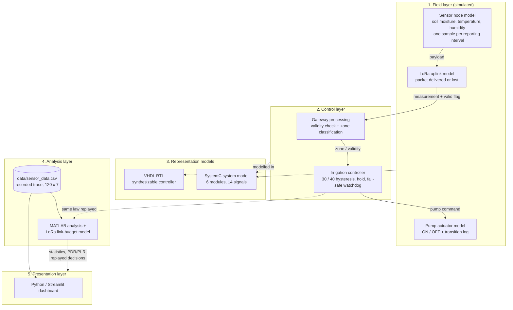

**Architectural principles applied**

1. **Separation of concerns.** Measurement validity (`SoilMoistureProcessor`), decision making
   (`IrrigationController`) and actuation (`PumpActuator`) are separate modules with explicit interfaces.
   The controller never sees a raw sample that has not been validated.
2. **One control law, several representations.** The decision rule is specified once (§12) and implemented in
   MATLAB, VHDL, SystemC and (for the recommendation tab) Python; §16 verifies that the representations agree.
3. **Deterministic, self-checking simulation.** Every model runs without random inputs (the SystemC scenario and
   the MATLAB comparison values are fixed), so a reviewer can re-run the project and obtain identical numbers.
4. **File-based interfaces.** Components exchange data only through files — the dataset, the exported CSVs and
   the simulator transcripts. There is no hidden state and no co-simulation bridge.

**What the architecture does *not* contain:** a physical radio, a gateway device, a cloud service, a database
server, an FPGA bitstream, or any real-time operating system. Each of those would be a separate engineering
phase.

---

## 7. Hardware and Software Components

### 7.1 Hardware

| Item | Status |
|---|---|
| Sensor node (MCU + soil/temperature/humidity probes) | **not present** — modelled in SystemC `SensorMonitor` and in the synthetic dataset |
| LoRa transceiver (e.g. SX1276-class) | **not present** — modelled statistically (MATLAB) and at packet level (SystemC) |
| Gateway | **not present** — the "gateway" is the processing stage of the model |
| Pump, relay, valve | **not present** — the actuator is a 0/1 signal plus a statistics module |
| FPGA board | **not present** — the controller exists as RTL and was verified by simulation only |
| Workstation used for all runs | macOS 26.7, x86_64 (Intel) — *this is the only hardware involved, and it is not part of the system* |

Because no hardware was characterized, **no claim is made** about sensor accuracy, radio range, link
availability in a field, energy consumption or actuator behaviour. The LoRa parameters used by the model are
documented assumptions taken from public datasheets and are configurable (`matlab/functions/lora_default_config.m`).

### 7.2 Software

| Tool | Version verified on this machine | Role in the project |
|---|---|---|
| MATLAB | **R2025a Update 1** (25.1.0.2973910) | data analysis, control-law replay, link-budget model, figure generation |
| Python | **3.9.6** (project virtual environment) | dashboard, integration harness |
| Streamlit | **1.50.0** | dashboard framework |
| pandas / NumPy | **2.3.3 / 2.0.2** | tabular data handling |
| Plotly | **7.1.0** | interactive charts |
| scikit-learn | **1.6.1** | demonstration classifier referenced by the dataset's `ML advice` column |
| GHDL | **5.1.1** (LLVM 20.1.6 backend, VHDL-2008) | VHDL analysis, elaboration and simulation |
| SystemC | **2.3.4** (Accellera, built locally) | system-level simulation library |
| clang++ | **Apple clang 21.0.0** (x86_64 target) | C++ compiler for the SystemC model |
| GNU make | 3.81 | build automation for the SystemC model |
| CMake | 3.25.0 | used once to build the SystemC library itself |

No MATLAB toolbox is required (no Simulink, no Communications Toolbox, no Signal Processing Toolbox); the
LoRa model is implemented from first principles in plain MATLAB code, which is itself part of the engineering
contribution.


---

## 8. Sensor Data Collection

### 8.1 Dataset structure

All analysis in the project starts from one file, `data/sensor_data.csv`
(9 955 bytes, 121 lines, UTF-8, LF line endings, MD5 `9a8343666e45799de22dca5cdbeb977c`). It contains
**120 samples** with seven columns:

| # | Column (verbatim) | Type | Unit | Kind |
|---|---|---|---|---|
| 1 | `Sample` | integer, 0…119 | — | sample and packet index |
| 2 | `Soil moisture (%)` | real | % | measurement (synthetic) |
| 3 | `Temperature (°C)` | real | °C | measurement (synthetic) |
| 4 | `Air humidity (%)` | real | % | measurement (synthetic) |
| 5 | `Packet received` | `True` / `False` | — | link telemetry |
| 6 | `Pump` | `ON` / `OFF` | — | **derived** actuator state |
| 7 | `ML advice` | two phrases | — | **derived** demonstration output |

Columns 6 and 7 are decisions, not measurements; presenting them as sensor readings would be incorrect.
The dataset describes a *monitoring run*, not a hardware measurement campaign: it was produced by an earlier
version of the project's own generator, and §19 records that it cannot currently be regenerated from the code.

### 8.2 Descriptive statistics

For a series $x_1,\dots,x_N$ the mean and the sample standard deviation are

$$\bar{x}=\frac{1}{N}\sum_{i=1}^{N}x_i,
\qquad
s=\sqrt{\frac{1}{N-1}\sum_{i=1}^{N}\left(x_i-\bar{x}\right)^2 }.$$

| Statistic | Soil moisture (%) | Air temperature (°C) | Air humidity (%) |
|---|---|---|---|
| $N$ | 120 | 120 | 120 |
| Mean $\bar{x}$ | **41.4256** | **25.4417** | **54.2380** |
| Median | 40.5084 | 26.1556 | 52.6036 |
| Std. dev. $s$ | 12.5750 | 3.1877 | 7.9748 |
| Minimum | 13.9366 (sample 105) | 18.5288 | 39.7297 |
| Maximum | 62.8188 (sample 51) | 30.6118 | 75.3435 |
| Range | 48.8823 | 12.0830 | 35.6137 |

Soil moisture is the most dynamic variable ($s\approx12.6$ percentage points) and spans both thresholds, so the
recorded run exercises all three control branches (ON, hold, OFF). The three signals are physically coherent:
the empirical correlations are $r(\text{soil},\text{temperature})=+0.8420$,
$r(\text{soil},\text{humidity})=-0.8319$ and $r(\text{temperature},\text{humidity})=-0.8707$ — warm, dry air
coincides with drier soil, which is what a physically consistent generator should produce.

### 8.3 Data integrity checks

| Check | Result |
|---|---|
| Missing / blank values | 0 |
| Duplicate sample indices or duplicate rows | 0 |
| Values outside physical ranges (soil and humidity 0…100 %, temperature −20…60 °C) | 0 |
| Invalid link tokens in `Packet received` | 0 (only `True` / `False`) |
| Invalid pump tokens | 0 (only `ON` / `OFF`) |
| Sample index | contiguous 0…119 |

Both consumers resolve every column: the dashboard declares six literal column names that all exist in the
header, and the MATLAB loader resolves its seven punctuation-insensitive keys against the same header
(verified in §16, checks I-02).

### 8.4 Delivery metrics of the recorded run

With $N$ samples, $N_{\text{rx}}$ received and $N_{\text{lost}}=N-N_{\text{rx}}$:

$$\mathrm{PDR}=\frac{N_{\text{rx}}}{N}\times100\,\%,
\qquad
\mathrm{PLR}=\frac{N_{\text{lost}}}{N}\times100\,\%,$$

$$\mathrm{PDR}+\mathrm{PLR}=100\,\%.$$

For the recorded dataset: $N=120$, $N_{\text{rx}}=116$, $N_{\text{lost}}=4$, therefore

$$\mathrm{PDR}=96.6667\,\%,\qquad \mathrm{PLR}=3.3333\,\%.$$

The four losses occur at samples 41, 44, 96 and 100, each an isolated single-packet loss (longest outage =
1 packet), so the link degrades gracefully rather than producing a long blind period.

### 8.5 Recorded sensor trends


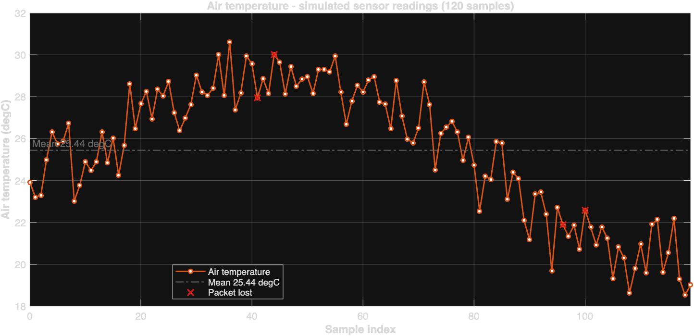

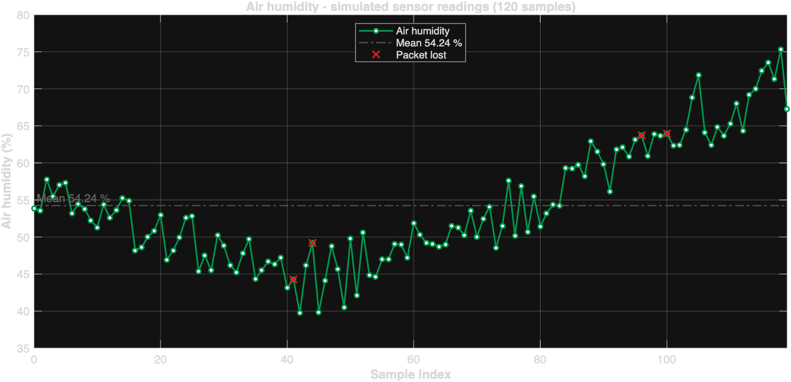


---

## 9. IoT Monitoring Dashboard

### 9.1 Implementation

The dashboard is a Streamlit application (`python_dashboard/app.py`, 823 lines) that is driven **only** by
`data/sensor_data.csv`: no value is generated at run time, so every figure on screen is traceable to the
recorded file. The path is resolved from `__file__`, so the application works regardless of the current
directory. Loading is wrapped in a validation layer (`load_sensor_data`) that

* verifies the file exists and parses as CSV;
* checks that the seven required columns are present and reports any that are missing;
* coerces the numeric columns and counts non-numeric entries;
* converts the boolean columns through a tolerant parser (`True/False`, `1/0`, `YES/NO`, …) and counts
  unrecognised tokens;
* applies physical range checks and removes unusable rows (reporting how many);
* removes duplicate sample indices and sorts by `Sample`.

If the dataset is missing or unusable the application displays an explicit error with the expected path and
**stops** — it never falls back to synthetic values.

### 9.2 Presentation and analytics

| Tab | Content |
|---|---|
| Overview | system status banner, alert list, soil-moisture chart with threshold bands |
| Sensor readings | soil moisture, temperature and humidity trends with mean lines, plus a statistics table (mean, min, max, σ, latest) |
| Communication | packets received/lost, loss events, longest outage, reception strip, cumulative PDR with the 90 % target |
| Irrigation control | pump ON counts for the recorded state and for the replayed law, control-law agreement, per-sample recommendation for the latest 15 samples |
| Data quality | nine validation checks with OK/Check verdicts |
| Raw data | the full 120-row table with a CSV download |

Twelve key-performance indicators are computed from the loaded data, for example the delivery ratio
$\mathrm{PDR}=116/120=96.7\,\%$, the mean soil moisture $41.4\,\%$ and the pump-on count $44$ of 120 samples.

### 9.3 Replay of the control law

The dashboard does not read the `Pump` column to make its recommendation: it **replays the documented law** on
the recorded soil-moisture and packet-reception values, which allows a direct comparison between what the
dataset records and what the written specification implies. On the recorded dataset the replayed law agrees
with the recorded pump state on **120 of 120 samples (100 %)**, which is strong evidence that the dataset and
the specification describe the same controller.

### 9.4 Alerts and operator information

Rule-based alerts are derived from the data, not hard-coded conclusions: dry soil at the latest sample,
degraded delivery ratio ($<90\,\%$ warning, $<75\,\%$ critical), stale telemetry (trailing losses), extreme
temperature or humidity, pump ON while the soil is above the wet threshold, out-of-range values, dropped rows
and disagreement between the recorded and replayed pump state.

### 9.5 Testing

A self-checking test-suite (`python_dashboard/tests/run_tests.py`, 157 lines) drives the real application
through Streamlit's `AppTest` harness — no browser is required:

| Test | Expectation | Result |
|---|---|---|
| clean dataset | no exception, all 120 rows presented | pass |
| counters | delivered 116, lost 4, pump ON 44 (values read from the CSV) | pass |
| replayed law | 100.0 % agreement with the recorded pump | pass |
| layout | 6 tabs, 7 charts, 5 tables | pass |
| threshold interaction | changing 30/40 → 50/60 changes the replayed pump count | pass |
| missing dataset | explicit error naming the expected path, no crash | pass |
| malformed header | error listing the missing columns | pass |
| dirty data | five validation checks flagged, no crash | pass |

**Result: 13/13 checks passed.** The dashboard is therefore *tested*, but it must be emphasised that it is a
**local Streamlit application**, not a deployed IoT cloud service; no remote database, MQTT broker or user
authentication exists.


---

## 10. LoRa Communication Simulation

### 10.1 From a statistical abstraction to a link-level model

The project originally represented the radio link as a constant packet-loss probability
(`packetLossProbability = 0.04`). That abstraction answers *"what happens when data is missing?"* but not
*"why and when is data missing?"*. A link-level model was therefore added
(`matlab/functions/lora_*.m`, driver `matlab/lora_link_simulation.m`), in which the reception decision is
derived from the link budget instead of being drawn from a constant. Table 10.1 summarises the difference.

**Table 10.1 — Statistical abstraction versus link-level model**

| Aspect | Statistical model | Link-level model (implemented) |
|---|---|---|
| Reception decision | independent coin flip | derived from received power → SNR → margin → PER |
| Depends on distance | no | yes (path loss + shadowing) |
| Depends on modulation | no | yes (airtime and sensitivity depend on SF/BW/CR) |
| Regulatory constraints | ignored | duty cycle checked against the airtime |

### 10.2 Packet transmission model — time on air

LoRa uses chirp spread spectrum. With spreading factor $SF$, bandwidth $BW$ and coding rate $CR$, the symbol
duration and the number of payload symbols are

$$T_{\text{sym}}=\frac{2^{SF}}{BW},
\qquad
n_{\text{payload}}=8+\max\!\left(\left\lceil\frac{8L-4SF+28+16\,\mathrm{CRC}-20\,\mathrm{IH}}{4(SF-2\,\mathrm{DE})}\right\rceil\left(CR+4\right),0\right),$$

and the time on air of one packet of $L$ payload bytes is

$$T_{\text{air}}=\left(n_{\text{preamble}}+4.25+n_{\text{payload}}\right)T_{\text{sym}}.$$

Here $IH=1$ for an explicit header, $CRC=1$ when the payload CRC is enabled and $DE=1$ when the low-data-rate
optimisation is active (mandatory for $SF\ge11$ at 125 kHz). Table 10.2 reports the values computed by
`lora_time_on_air.m` for a 16-byte payload, $BW=125$ kHz, $CR=4/5$ and an 8-symbol preamble.

**Table 10.2 — Airtime and duty-cycle budget per spreading factor**

| SF | $T_{\text{sym}}$ (ms) | Payload symbols | **Airtime (ms)** | Packets/h at 1 % duty | Duty used at 60 s interval |
|---|---|---|---|---|---|
| 7 | 1.0240 | 33 | **46.336** | 776.9 | 0.077 % |
| 8 | 2.0480 | 28 | **82.432** | 436.7 | 0.137 % |
| 9 | 4.0960 | 28 | **164.864** | 218.4 | 0.275 % |
| 10 | 8.1920 | 23 | **288.768** | 124.7 | 0.481 % |
| 11 | 16.3840 | 23 | **577.536** | 62.3 | 0.963 % |
| 12 | 32.7680 | 23 | **1155.072** | 31.2 | **1.925 %** |

The duty cycle follows $\delta=T_{\text{air}}/T_{\text{report}}$. With a 60 s reporting interval, $SF12$ requires
$\delta=1.925\,\%$, which **exceeds** the 1 % regulatory assumption for the EU868 band; the shortest legal
interval for that configuration is $T_{\text{air}}/0.01\approx115.5$ s. This is a concrete design consequence
that the statistical model could not express: choosing the longest range forces a slower reporting rate.

*Assumption:* $SF$, $BW$, $CR$, payload length and the reporting interval are engineering assumptions
(configurable in `lora_default_config.m`); they were not read from hardware.

### 10.3 Channel and receiver model

The received power is obtained from a log-distance path loss with a Friis reference at $d_0=1$ m and
log-normal shadowing $X_\sigma\sim\mathcal N(0,\sigma^2)$:

$$PL(d_0)=32.44+20\log_{10}\!\left(f_{\text{MHz}}\right)+20\log_{10}\!\left(d_{0,\text{km}}\right),$$

$$PL(d)=PL(d_0)+10\,n\log_{10}\!\left(\frac{d}{d_0}\right)+X_\sigma,
\qquad
P_{rx}=P_{tx}+G_{tx}+G_{rx}-L_{\text{cable}}-PL(d).$$

The thermal noise floor of the receiver and the resulting signal-to-noise ratio are

$$N=-174+10\log_{10}(BW)+F,
\qquad
\mathrm{SNR}=P_{rx}-N,$$

where $F$ is the receiver noise figure. Demodulation succeeds only above a spreading-factor-dependent SNR
threshold; defining the link margin relative to that threshold and an implementation loss $L_{\text{impl}}$,

$$M=\mathrm{SNR}-\left(\mathrm{SNR}_{\min}(SF)+L_{\text{impl}}\right).$$

The packet error probability is modelled with a logistic transition around the demodulation limit,

$$P_{\text{PER}}(M)=\frac{1}{1+e^{kM}},$$

with steepness $k$ (1.5 dB⁻¹ by default) and $P_{\text{PER}}(0)=0.5$. The sensitivity is then
$S=N+\mathrm{SNR}_{\min}(SF)+L_{\text{impl}}$, which for $SF7$, $BW=125$ kHz and $F=6$ dB gives
$N=-117.03$ dBm and $S=-123.03$ dBm — consistent with the datasheet value for that modem configuration, which
is why the 1.5 dB implementation loss is included.

**Table 10.3 — Model assumptions (all configurable)**

| Parameter | Value used | Origin |
|---|---|---|
| Region / carrier | EU868 / 868.1 MHz | regulatory assumption |
| $BW$ / $SF$ / $CR$ | 125 kHz / 7 / 4-5 | LoRaWAN default configuration |
| Payload | 16 bytes | typical sensor frame (assumption) |
| $P_{tx}$, $G_{tx}$, $G_{rx}$ | 14 dBm, 0 dBi, 0 dBi | datasheet maximum, small antennas |
| Noise figure $F$ | 6 dB | typical low-cost front end |
| $\mathrm{SNR}_{\min}$ | −7.5 … −20 dB for SF7…SF12 | datasheet table |
| Path-loss exponent $n$ | 2.8 | suburban (2.0 = free space) |
| Shadowing $\sigma$ | 6 dB | suburban, drawn per packet |
| $k$ (PER steepness) | 1.5 dB⁻¹ | modelling assumption |
| Duty-cycle limit | 1 % | EU868 regulatory assumption |


### 10.4 Simulated results

**Nominal link at 450 m (\(SF7\), no shadowing).** Path loss $105.50$ dB, received power $-91.50$ dBm, noise
floor $-117.03$ dBm, $\mathrm{SNR}=25.53$ dB, margin $M=+31.53$ dB, sensitivity $-123.03$ dBm. The margin is so
large that the packet error probability is below $10^{-6}$; the simulation therefore delivers **120/120 packets
(PDR 100 %, PLR 0 %)**.

**Distance dependence.** Table 10.4 reports the simulated delivery ratio for a sweep of 400 packets per point
(means over the shadowing realisations).

**Table 10.4 — Simulated PDR versus distance (\(SF7\), $n=2.8$, $\sigma=6$ dB)**

| Distance | Path loss | $P_{rx}$ | SNR | Margin | Mean PER | **PDR** |
|---|---|---|---|---|---|---|
| 100 m | 87.39 dB | −73.39 dBm | 43.64 dB | +49.64 dB | ≈0 | **100.00 %** |
| 493 m | 106.81 dB | −92.81 dBm | 24.22 dB | +30.22 dB | 4·10⁻⁸ | **100.00 %** |
| 1 633 m | 121.31 dB | −107.31 dBm | 9.72 dB | +15.72 dB | 0.0050 | **99.50 %** |
| 3 626 m | 130.54 dB | −116.54 dBm | 0.49 dB | +6.49 dB | 0.157 | **83.25 %** |
| 12 000 m | 145.47 dB | −131.47 dBm | −14.44 dB | −8.44 dB | 0.909 | **9.25 %** |

The simulated range for a 90 % delivery target is approximately **3.6 km** for the assumed suburban channel.
Beyond that the curve falls steeply, which is the expected behaviour of a link-budget-limited system.

**Table 10.5 — Failure scenarios (120 packets each)**

| Scenario | Delivered | Lost | **PDR** | **PLR** | Loss events | Longest outage |
|---|---|---|---|---|---|---|
| Recorded dataset (reference) | 116 | 4 | **96.6667 %** | **3.3333 %** | 4 | 1 |
| Nominal 450 m | 120 | 0 | **100.0000 %** | **0.0000 %** | 0 | 0 |
| Burst outage, packets 90–110 | 99 | 21 | **82.5000 %** | **17.5000 %** | 1 | **21** |
| Interference burst, 5 km, +3 dB, packets 95–108 | 71 | 49 | **59.1667 %** | **40.8333 %** | 29 | 5 |
| \(SF9\) at 5 km | 107 | 13 | **89.1667 %** | **10.8333 %** | 11 | 3 |
| \(SF12\) at 5 km | 119 | 1 | **99.1667 %** | **0.8333 %** | 1 | 1 |

Inside the forced outage window all 21 packets are lost; inside the interference window 10 of 14 packets are
lost (delivery inside the window 28.6 % against a 62.5 % baseline for the same 5 km link).

**Spreading-factor trade-off at 5 km:** $SF7$ delivers 62.50 % at 46.3 ms per packet, $SF9$ delivers 89.17 % at
164.9 ms, and $SF12$ delivers 99.17 % at 1155.1 ms — the classic range-versus-airtime trade-off, quantified with
the project's own model.

### 10.5 An important negative result

At 450 m the model predicts a margin of $+31.5$ dB and therefore essentially error-free reception, yet the
recorded dataset shows 3.33 % loss. **The recorded loss is therefore not explained by distance or path loss.**
It is a statistical abstraction that stands for unspecified impairments (interference, collisions, gateway
downtime, obstruction). The `outage` and `interference` scenarios exist precisely to represent those causes
explicitly instead of hiding them inside a constant probability. Reporting the model's 100 % PDR at 450 m as a
"validation" of the recorded 3.33 % would be wrong, and is not done here.

### 10.6 Figures

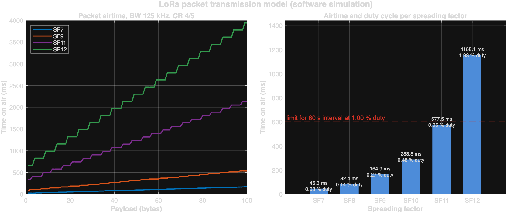

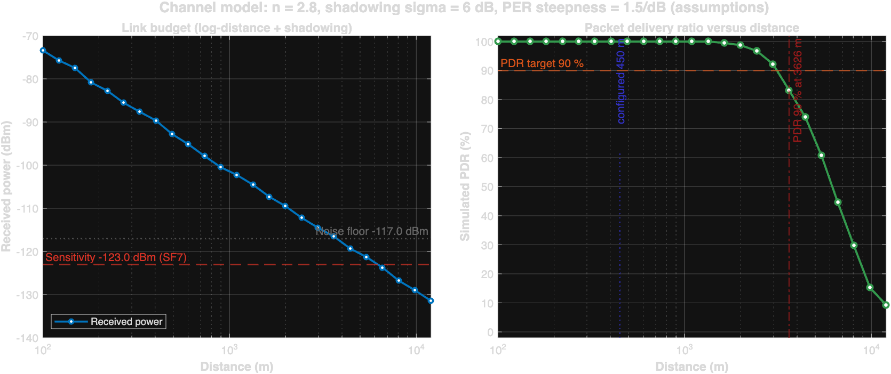

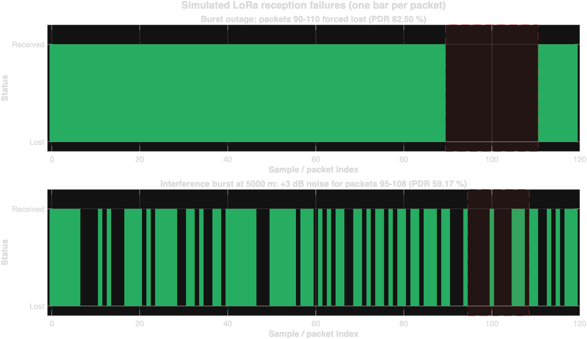

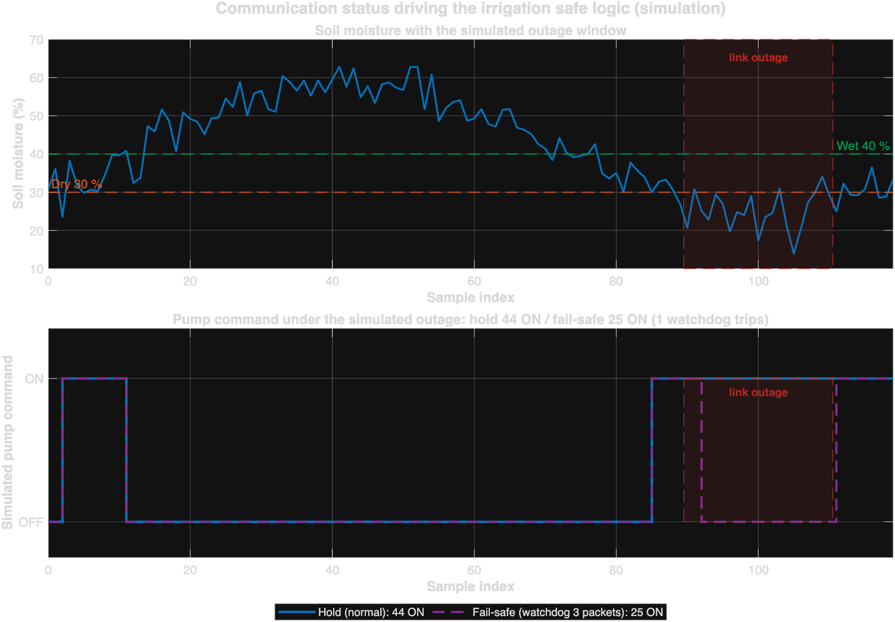

**Verification.** The LoRa driver executes **15 self-checks**, all passing: airtime $SF7=46.336$ ms and
$SF12=1155.072$ ms (matching the published LoRa calculator values), $SF7$ sensitivity $-123.03$ dBm, noise floor
$-117.03$ dBm, shadow-free margin at 450 m $31.53$ dB, deterministic repetition with a private random stream,
monotonic PDR versus distance, and no pump state change caused by a lost packet.


---

## 11. MATLAB Simulation

### 11.1 Structure of the MATLAB layer

The MATLAB layer is one driver script plus eleven functions (`matlab/functions/`), so that the same code is
reused by the analysis, the LoRa study and the integration harness:

| File | Responsibility |
|---|---|
| `smart_farm_complete.m` | driver: load → statistics → control → link → verify → figures → export |
| `load_sensor_data.m` | CSV import with column matching, type coercion and validation |
| `parse_boolean_column.m` | tolerant `True/False` parser (text, numeric or logical input) |
| `irrigation_control.m` | **the shared control law** (hold / fail-safe / legacy modes) |
| `packet_statistics.m` | PDR, PLR, loss events, longest outage, cumulative PDR |
| `plot_*.m` (5 files) | figure generation with titles, units, legends and grids |
| `lora_default_config.m`, `lora_time_on_air.m`, `lora_link_budget.m`, `lora_simulate_link.m` | LoRa link-level model (§10) |

`smart_farm_complete.m` resolves its paths from `mfilename('fullpath')`, so it runs from any working directory —
verified by executing it with the working directory set to `/tmp`.

### 11.2 Analysis results on the recorded data

| Quantity | Value |
|---|---|
| Rows read / used / dropped / duplicate | 120 / 120 / 0 / 0 |
| Mean soil moisture / temperature / humidity | 41.4256 % / 25.4417 °C / 54.2380 % |
| Packets transmitted / delivered / lost | 120 / 116 / 4 |
| PDR / PLR | 96.6667 % / 3.3333 % |
| Loss events / longest outage | 4 / 1 packet |

### 11.3 Controller comparison (the central MATLAB result)

**Table 11.1 — Strategies evaluated on the recorded soil-moisture sequence**

| Strategy | Pump ON samples | ON share | Transitions | Agreement with recorded `Pump` |
|---|---|---|---|---|
| **Documented law** (30/40 hysteresis, hold on loss) | **44** | 36.67 % | **3** | **100.00 %** (120/120) |
| Documented law + fail-safe watchdog | 44 | 36.67 % | 3 | 100.00 % (no trip needed) |
| Legacy single threshold (`soil < 30`) | **27** | 22.50 % | **18** | 85.83 % (103/120) |

The single-threshold rule is retained **only** as a quantitative argument: it under-irrigates by 17 samples and
produces six times more pump transitions (18 versus 3). This is the measured justification for hysteresis.

### 11.4 Figures produced by the analysis

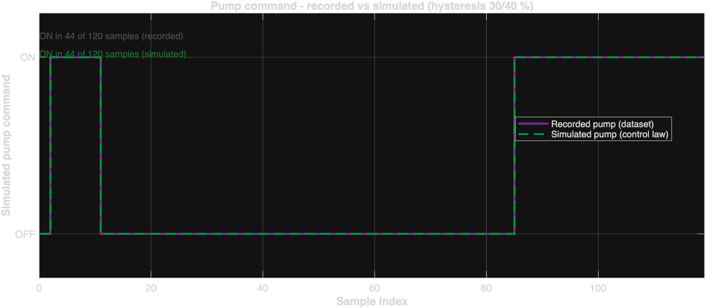

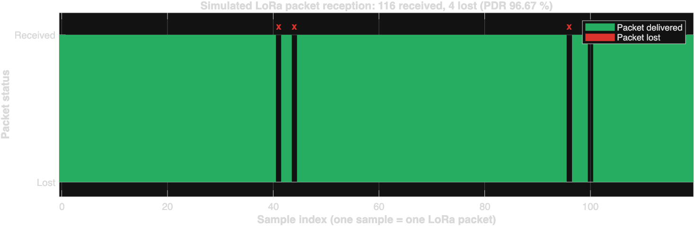

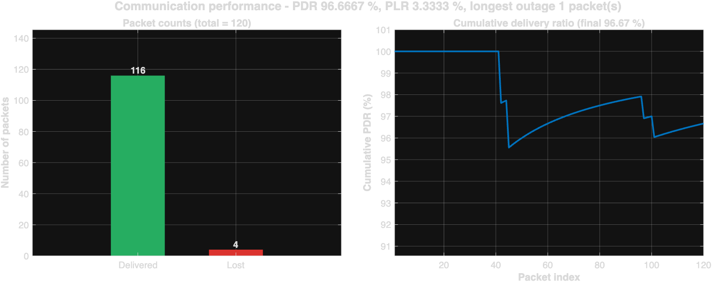

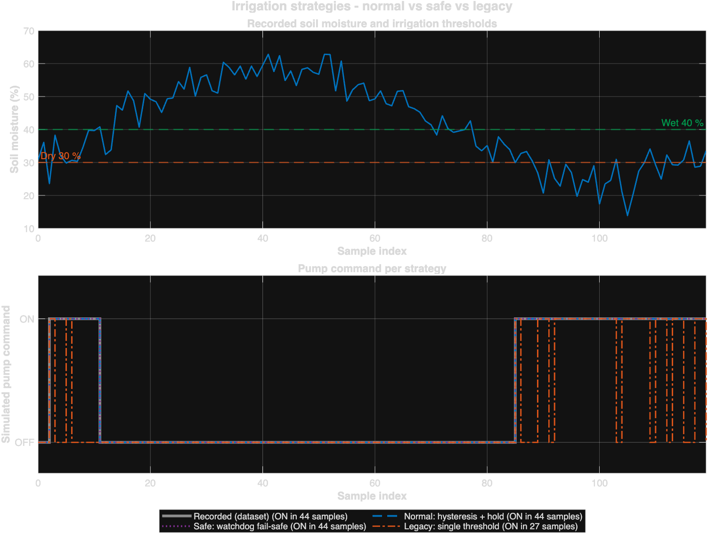

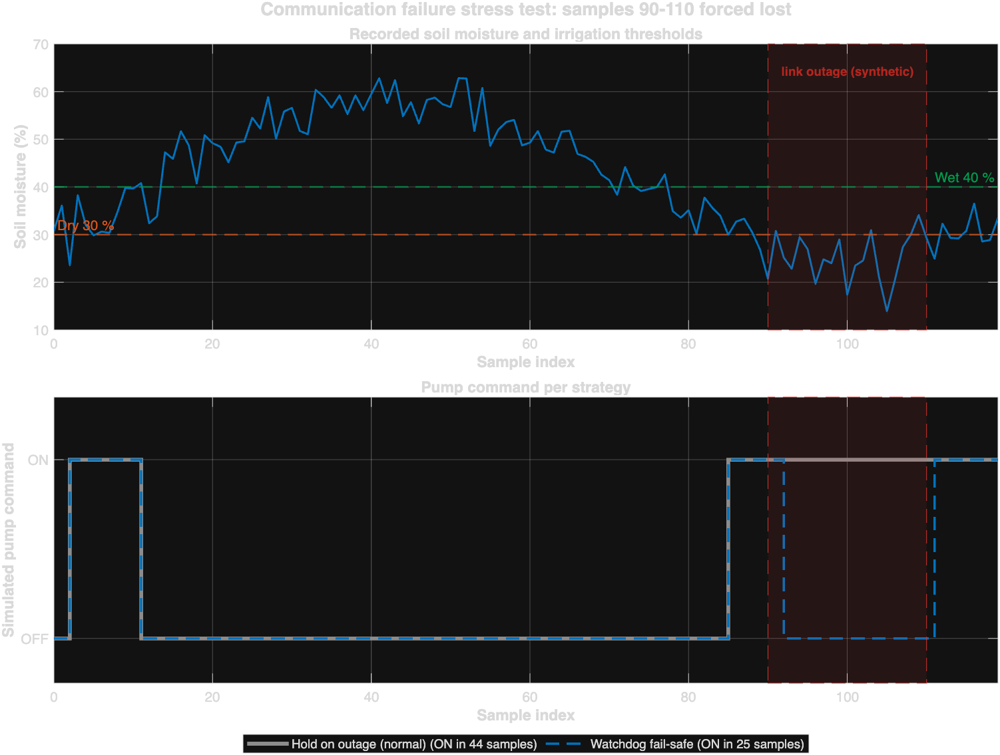

### 11.5 Self-verification

`smart_farm_complete.m` ends with **22 verification checks** that compare computed quantities with independently
derived expected values using explicit tolerances (the three means against the independent Python recomputation,
PDR/PLR, pump counts, hysteresis compliance, no state change on lost packets, rejection of invalid thresholds).
All 22 passed. A failing check raises a MATLAB warning so it cannot be overlooked.


---

## 12. Automatic Irrigation Algorithm

### 12.1 Specification

Let $s_k$ be the soil moisture of sample $k$ in percent, $v_k\in\{0,1\}$ the validity of the corresponding
telemetry packet and $u_k\in\{0,1\}$ the pump command, with dry and wet thresholds $\theta_d=30$ and
$\theta_w=40$:

$$
u_k=
\begin{cases}
1, & v_k=1 \ \text{and}\ s_k<\theta_d, & \text{soil too dry → irrigate}\\
0, & v_k=1 \ \text{and}\ s_k>\theta_w, & \text{soil wet enough → stop}\\
u_{k-1}, & v_k=1 \ \text{and}\ \theta_d\le s_k\le\theta_w, & \text{hysteresis band → hold}\\
u_{k-1}, & v_k=0, & \text{no telemetry → hold}
\end{cases}
$$

with the initial condition $u_0=0$ (pump OFF, the safe state). In the optional **fail-safe** policy the last
branch is replaced by a watchdog on the number $\ell_k$ of consecutive invalid samples:

$$u_k=0 \quad\text{whenever}\quad v_k=0 \ \text{and}\ \ell_k\ge L,\qquad L=3\ \text{(MATLAB, SystemC)}.$$

### 12.2 Why hysteresis is necessary

Without hysteresis the decision is a pure threshold function of a noisy signal. When the measurement fluctuates
around the threshold, a spurious transition occurs whenever consecutive samples straddle it, an event whose
probability grows with the ratio between the measurement noise $\sigma$ and the sample-to-sample change
$\Delta s$. In the recorded run that ratio is of order unity, so a single threshold produces frequent switching:
the measured result is **18 pump transitions** against **3** for the hysteresis version (Table 11.1). A band of
width $\theta_w-\theta_d=10$ percentage points forces a transition to cross the whole band, which suppresses
chatter at either threshold. The cost is a slightly slower reaction to drying, which is acceptable for a soil
process whose time constant is of the order of hours.

### 12.3 Communication-failure safety mechanism

The mechanism addresses a genuine hazard: **the controller must never act on data it does not have.** It has
three layers of increasing restriction.

1. **Validity gating.** A sample is used only if the packet was received *and* the value is physically plausible
   ($s_k\le100\,\%$). A corrupted payload cannot reach the decision logic.
2. **Hold on loss.** With no valid sample the controller keeps its last output: the last known state is a better
   estimate of the field than an arbitrary default. This is the documented behaviour and the default of every
   component.
3. **Fail-safe watchdog.** If telemetry is missing for $L$ consecutive samples the pump is forced OFF. Prolonged
   blindness is treated as a reason to stop irrigating rather than to continue blindly; irrigation resumes
   automatically when valid, dry measurements return.

The trade-off is quantified rather than asserted. In the golden scenario (§16) both policies behave identically
while telemetry is available and during an outage that begins with the pump OFF; they differ only where an
outage begins with the pump ON — the watchdog stops irrigation after three lost packets while hold continues. In
the 21-packet outage of `Fig8` that difference is **19 samples** (44 versus 25 pump-ON samples). Neither policy is
universally correct: the watchdog protects against over-irrigation and a pump running dry, whereas hold protects
the crop during a short radio glitch. The behaviour is therefore a design parameter ($L$), and both variants are
implemented and tested.

### 12.4 Verification of the algorithm

| Verification | Method | Result |
|---|---|---|
| Rule implemented as specified | hand-checked sequence `soil = [25 35 45 35(lost) 25]` → `pump = [1 1 0 0 1]` | pass |
| Rule reproduces the recorded controller | replay over the 120 recorded samples | 120/120 (100 %) |
| Rule is stable | pump transitions versus a single threshold | 3 versus 18 |
| Rule is safe on loss | pump state changes on the four recorded lost packets | 0 |
| Rule is portable | identical thresholds and hold behaviour in MATLAB, VHDL, SystemC, Python | §16, check I-03 |


---

## 13. VHDL Controller Design

### 13.1 Entity and configuration

The controller is synthesizable RTL (`vhdl/irrigation_controller.vhd`, 104 lines) with a stable port list and
four configurable generics:

```vhdl
entity irrigation_controller is
    generic (
        DRY_THRESHOLD     : integer := 30;
        WET_THRESHOLD     : integer := 40;
        HYSTERESIS_ENABLE : boolean := true;   -- false -> single threshold
        FAILSAFE_ON_LOSS  : boolean := false   -- true  -> pump OFF when data is missing
    );
    port (
        clk, reset_n, packet_valid : in  std_logic;
        soil_moisture              : in  unsigned(7 downto 0);
        pump_enable                : out std_logic
    );
end entity;
```

The generics let one architecture cover both the documented law (hysteresis, hold) and the stricter variant
(single threshold, fail-safe OFF) without editing the code. The defaults reproduce the documented law, so the
module stays compatible with the rest of the project.

### 13.2 Architecture

The datapath is a single clocked process with an asynchronous active-low reset and a registered output:

```vhdl
sample_ok <= (packet_valid = '1') and (to_integer(soil_moisture) <= SOIL_MAX_PERCENT);

control : process (clk, reset_n)
begin
    if reset_n = '0' then
        pump_state <= '0';                       -- safe state
    elsif rising_edge(clk) then
        if sample_ok then
            if moisture < DRY_THRESHOLD then      pump_state <= '1';
            elsif HYSTERESIS_ENABLE then
                if moisture > WET_THRESHOLD then  pump_state <= '0'; end if;
            else                                  pump_state <= '0'; end if;
        elsif FAILSAFE_ON_LOSS then
            pump_state <= '0';
        end if;
    end if;
end process;
```

Properties worth noting:

* **One clock domain, one driver** — no latches, no inferred memories, no secondary clocks.
* **Asynchronous reset dominates** and forces the safe state (OFF) immediately, without waiting for an edge.
* **Sample validation in hardware**: values above 100 % are treated exactly like a lost packet rather than
  being used — the hardware equivalent of the gateway validity check.
* **Generic guard**: a concurrent assertion rejects $WET\_THRESHOLD\le DRY\_THRESHOLD$ when simulation starts,
  so a mis-configured instance cannot run silently.
* **Level semantics of `packet_valid`**: a *valid-at-this-edge* qualifier rather than an event; documented in
  the header and exercised by the testbench.

### 13.3 Synthesis check

The RTL was passed through `ghdl --synth --std=08`, which completed successfully, confirming that only
synthesizable constructs are used. This is **not** a timing-closure or place-and-route result: no FPGA device,
constraint file, static timing analysis or bitstream is part of this work.


---

## 14. GHDL Verification

### 14.1 The problem with the original testbench

The first version of `irrigation_controller_tb.vhd` generated stimulus but was not connected to the design: no
instantiation, no `port map`, no assertions. Its complete simulation output was two lines
(`Simulation finished` at 100 ns, then "stopped by `--stop-time`") with **zero checks**, and the DUT output
remained at `'U'` throughout. Such a testbench can never fail and therefore verifies nothing.

### 14.2 The rewritten testbench

The testbench instantiates the design **three times** with different generics, so every supported configuration
is verified by the same stimulus:

| Instance | `HYSTERESIS_ENABLE` | `FAILSAFE_ON_LOSS` | Behaviour verified |
|---|---|---|---|
| `dut_hold` | true | false | documented law (hysteresis + hold) |
| `dut_failsafe` | true | true | documented law + fail-safe OFF |
| `dut_strict` | false | true | single threshold (≥ 30 % → OFF) + fail-safe OFF |

A local procedure performs the comparisons, counts passes and failures and reports the observed value on every
line. The simulation terminates through `std.env.finish(0/1)`, so the exit code is meaningful and the run no
longer depends on an external stop condition.

### 14.3 Test cases and result

**23 stimulus steps × 3 instances = 69 assertions**, covering asynchronous reset (with and without a clock
edge), dry soil, the hysteresis band, wet soil, communication loss while the pump is OFF and while it is ON, the
exact thresholds 29/30/40/41 %, the maximum valid value 100 %, out-of-range values 101 % and 150 %,
repeatability, and restart after reset.

**Table 14.1 — Representative assertions (expected / actual, all passing)**

| # | Stimulus | `dut_hold` | `dut_failsafe` | `dut_strict` |
|---|---|---|---|---|
| 2 | dry 20 %, telemetry OK | 1 / **1** | 1 / **1** | 1 / **1** |
| 3 | band 35 %, telemetry OK | 1 / **1** | 1 / **1** | 0 / **0** |
| 4 | wet 45 %, telemetry OK | 0 / **0** | 0 / **0** | 0 / **0** |
| 6 | loss of telemetry while pump OFF | 0 / **0** | 0 / **0** | 0 / **0** |
| 8 | **loss of telemetry while pump ON** | 1 / **1** | 0 / **0** | 0 / **0** |
| 10, 12 | exact thresholds 30 % and 40 % | 1 / **1** | 1 / **1** | 0 / **0** |
| 22 | asynchronous reset, no clock edge | 0 / **0** | 0 / **0** | 0 / **0** |

**Result: 69 assertions executed, 69 passed, 0 failed**, `simulation finished @256ns with status 0`, exit code 0.
Analysis, elaboration, extended-warning analysis and the synthesis check completed without diagnostics from the
project code.

### 14.4 A real defect found by the new testbench

The first refactored version of the RTL evaluated `elsif (not HYSTERESIS_ENABLE) or (moisture >= WET_THRESHOLD)`,
which switched the pump OFF at **exactly 40 %** instead of only *above* 40 %. The testbench reported 67 passes
and **2 failures** (`exact wet threshold 40 % | expected '1' but got '0'`). The branch was split into an explicit
hysteresis branch (`moisture > WET_THRESHOLD`) and an explicit single-threshold branch, after which all 69 checks
passed. The defect was invisible in the original code base and would have produced a wrong pump command at the
boundary value.


---

## 15. SystemC Simulation

### 15.1 Motivation and architecture

SystemC models the *whole system* rather than a single block: it is the only place where the sensor node, the
link, the gateway processing, the controller and the actuator coexist and communicate through signals over
simulated time. The model (`systemc/src/`, six modules plus a testbench) is organised as follows.

| Module | Interface | Behaviour |
|---|---|---|
| `SensorMonitor` | `step_index` → soil, `sample_ready`, temperature, humidity | one measurement per cycle; soil from the scenario, temperature and humidity synthetic |
| `LoRaLink` | `link_ok`, `sample_ready`, payload → payload, `packet_ready` | register stage: payload and validity published together; counts sent/delivered/lost and the longest outage |
| `SoilMoistureProcessor` | payload, `packet_ready` → `zone`, `valid` | classifies dry/band/wet; holds the last class, marks it invalid when data is missing |
| `IrrigationController` | soil, `packet_ready` → `pump_cmd` | the law of §12; policy (`hold` or `fail-safe`) chosen in the constructor |
| `PumpActuator` | `pump_cmd` → `running` | registers the command, logs transitions, counts ON cycles and starts |
| `SmartFarmTB` | — | instantiates the modules, binds 14 signals, drives the 7-step scenario, performs the checks |

All datapath modules are `SC_METHOD`s sensitive to the rising clock edge; only the testbench uses a thread. This
removes the delta-cycle race that affected the original single-file prototype, in which two `SC_THREAD`s
sensitive to the same edge could read each other's outputs in an unspecified order.

### 15.2 Communication-failure behaviour

Two controller instances are driven by the same link output, so the difference between the policies is measured
rather than asserted:

| Situation | link | `hold` pump | `fail-safe` pump |
|---|---|---|---|
| outage begins with the pump OFF | DOWN for 8 cycles | OFF (held) | OFF |
| outage begins with the pump ON | DOWN for 8 cycles | **ON (held)** | **OFF after 3 losses** |

### 15.3 Simulation results

```
simulated time          : 56500 ms          sensor samples : 57
packets sent/delivered  : 55 / 39           packets lost   : 16  (longest outage 8 cycles)
valid / invalid samples : 38 / 19
controller 'hold'       : ON 39 cycles, 2 activations, 0 watchdog trips
controller 'fail-safe'  : ON 33 cycles, 3 activations, 1 watchdog trip
pump 'hold'   : ON 38 / OFF 19 cycles       pump 'fail-safe' : ON 32 / OFF 25 cycles
checks executed : 14        checks failed : 0        RESULT : PASS
```

The difference between the controller ON-cycles (39/33) and the actuator ON-cycles (38/32) is the registered
latency of the actuator stage — a property of the cycle-accurate model that the zero-delay MATLAB algorithm does
not have.

### 15.4 Two modelling defects found by running the simulation

1. In the first version the link published `packet_ready` in the same delta cycle in which it sampled the
   payload, so the **first delivered packet carried the power-up payload (0 %)** flagged as valid. The link now
   publishes the pair captured on the previous edge, so payload and validity are always consistent.
2. The link originally transmitted whenever the channel was up, even before the sensor had produced a sample. A
   `sample_ready` handshake was added, so a packet exists only when a measurement exists.

Both defects were detected from the transcript (an implausible `soil = 0 %` marked valid) and fixed before the
final passing run — evidence that executing the model was worth more than reading it.

**Result: 14/14 checks passed, exit code 0.**


---

## 16. System Integration

### 16.1 What is actually connected

Three real interfaces exist: `data/sensor_data.csv` → Python dashboard, `data/sensor_data.csv` → MATLAB, and
every component → `results/`. The VHDL/GHDL and SystemC simulations are **independent**: their stimulus comes
from an internal testbench and from a compiled scenario table respectively, and they exchange no data with the
other components at run time.

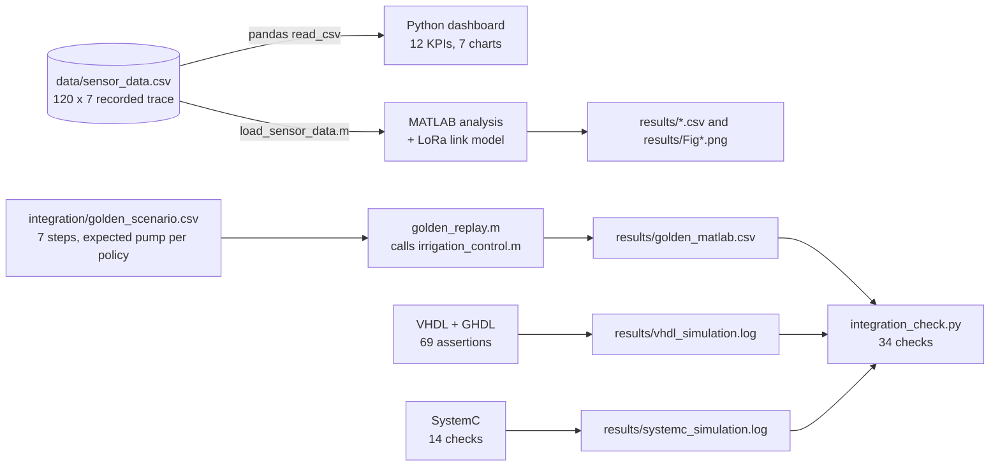

The golden scenario reaches the comparison **through files**: the three simulators never communicate; a Python
program compares their recorded outputs afterwards.

### 16.2 The golden scenario

`integration/golden_scenario.csv` expresses the specification **as data** — seven steps with the expected pump
state for both policies. MATLAB replays it through the *existing* `irrigation_control.m` (no new implementation),
while the SystemC and GHDL transcripts are parsed for the corresponding states.

**Table 16.1 — Cross-simulation result (expected hold/fail-safe → MATLAB, SystemC, VHDL)**

| Step | Scenario | Expected | MATLAB | SystemC | VHDL |
|---|---|---|---|---|---|
| 1 | dry soil 20 %, telemetry OK | 1 / 1 | ✅ 1/1 | ✅ 1/1 | ✅ 1/1 |
| 2 | normal soil 35 % (band) | 1 / 1 | ✅ 1/1 | ✅ 1/1 | ✅ 1/1 |
| 3 | wet soil 45 % | 0 / 0 | ✅ 0/0 | ✅ 0/0 | ✅ 0/0 |
| 4 | communication failure, pump OFF | 0 / 0 | ✅ 0/0 | ✅ 0/0 | ✅ 0/0 |
| 5 | telemetry restored, dry 25 % | 1 / 1 | ✅ 1/1 | ✅ 1/1 | ✅ 1/1 |
| 6 | **communication failure, pump ON** | **1 / 0** | ✅ 1/0 | ✅ 1/0 | ✅ 1/0 |
| 7 | telemetry restored, still dry | 1 / 1 | ✅ 1/1 | ✅ 1/1 | ✅ 1/1 |

**21 of 21 step-simulator combinations match the specification.**

### 16.3 Configuration agreement

| Component | Source | Dry | Wet | On lost packet |
|---|---|---|---|---|
| MATLAB | `irrigation_control.m` | **30** | **40** | hold (watchdog 3) |
| VHDL | `irrigation_controller.vhd` | **30** | **40** | hold; fail-safe = OFF on first loss |
| SystemC | `smart_farm_types.h` | **30** | **40** | hold (watchdog 3) |
| Python dashboard | `app.py` | **30** | **40** | hold (no fail-safe mode) |

Thresholds and the hold rule agree everywhere; the fail-safe mechanism deliberately differs between VHDL
(immediate) and MATLAB/SystemC (watchdog). That divergence is discussed in §18.3 and is not presented as
agreement.

### 16.4 Integration run

`integration/run_integration.sh` executes the whole system in dependency order and returns a single exit code.

| Step | Component | Result |
|---|---|---|
| 1 | dataset / configuration / data-flow checks | **34/34** |
| 2 | MATLAB analysis | **22/22** |
| 3 | MATLAB LoRa simulation | **15/15** |
| 4 | MATLAB golden replay | **7/7** |
| 5 | Python dashboard suite | **13/13** |
| 6 | VHDL + GHDL | **69/69** |
| 7 | SystemC | **14/14** |
| 8 | cross-component check (transcripts) | **34/34** |

```
ALL 8 STEPS PASSED
```


---

## 17. Experimental Results

### 17.1 Consolidated verification matrix

Every row below was produced by executing the referenced artefact on the workstation described in §7.

| # | Test suite | Artefact | Assertions | Failures | Exit code |
|---|---|---|---|---|---|
| 1 | Integration checks (schema, consumers, configuration, golden behaviour, safe state, data flow) | `integration/integration_check.py` | 34 | 0 | 0 |
| 2 | MATLAB analysis and control law | `matlab/smart_farm_complete.m` | 22 | 0 | 0 |
| 3 | LoRa link model | `matlab/lora_link_simulation.m` | 15 | 0 | 0 |
| 4 | Golden scenario replay (MATLAB) | `integration/golden_replay.m` | 7 | 0 | 0 |
| 5 | Dashboard | `python_dashboard/tests/run_tests.py` | 13 | 0 | 0 |
| 6 | VHDL controller | `vhdl/irrigation_controller_tb.vhd` | 69 | 0 | 0 |
| 7 | SystemC system model | `systemc/src/smart_farm_tb.h` | 14 | 0 | 0 |
| 8 | Cross-component check after the full run | `integration/integration_check.py` | 34 | 0 | 0 |
| | **Total** | | **208** | **0** | |

Additional non-assertion evidence: `ghdl --synth` completes; the SystemC build produces no warning from project
code; the dashboard renders 6 tabs, 12 KPIs and 7 charts from the real dataset; 12 figures and 11 CSV artefacts
are produced in `results/` (9 CSV files, 12 current figures, 2 transcripts).

### 17.2 Key quantitative findings

| Finding | Value | Source |
|---|---|---|
| Recorded delivery ratio | 96.6667 % (116/120) | `results/smart_farm_summary.csv` |
| Recorded packet loss ratio | 3.3333 % (4/120) | same |
| Mean soil moisture / temperature / humidity | 41.4256 % / 25.4417 °C / 54.2380 % | same |
| Agreement of the documented law with the recorded pump | **100.00 %** (120/120) | same, `controlLawAgreement` |
| Agreement of a single-threshold rule | 85.83 % (103/120) | `MATLAB_RESULTS.md` |
| Pump transitions: hysteresis vs single threshold | **3 vs 18** | `results/irrigation_mode_comparison.csv` |
| Airtime per packet, SF7 / SF12 (16 B, BW 125 kHz) | 46.336 ms / 1155.072 ms | `LORA_SIMULATION.md` |
| Link margin at 450 m, SF7, suburban channel | +31.53 dB | `results/lora_link_trace.csv` |
| Simulated range for PDR ≥ 90 % | ≈ 3.6 km | `results/lora_distance_sweep.csv` |
| Fail-safe difference during a 21-packet outage | 19 samples (44 vs 25 ON) | `results/lora_controller_comparison.csv` |
| VHDL assertions | 69/69 | `results/vhdl_simulation.log` |
| SystemC packets / lost / longest outage | 55 / 16 / 8 cycles | `results/systemc_simulation.log` |

### 17.3 What was measured, modelled and merely assumed

| Item | Category | Justification |
|---|---|---|
| Soil, temperature, humidity values | **recorded (synthetic)** | from `data/sensor_data.csv`, generated by the project's own model, not by a probe |
| Packet reception flags | **recorded (synthetic)** | same file; a statistical abstraction, not a radio measurement |
| PDR, PLR, mean, standard deviation | **computed** | exact arithmetic on the recorded file, reproduced twice (pandas and pure Python) |
| Control-law behaviour | **simulated** | MATLAB, VHDL and SystemC models, cross-checked against each other |
| Airtime, path loss, SNR, PER, range | **simulated** | equations of §10 with the assumptions of Table 10.3 |
| LoRa parameters (SF, BW, CR, power, noise figure) | **assumed** | published datasheet values, configurable, not measured on hardware |
| Sensor accuracy, field range, energy consumption | **not measured, not claimed** | no hardware exists |


---

## 18. Discussion

### 18.1 Hysteresis is justified by measurement, not by convention

The project does not merely *state* that hysteresis is better; it measures the difference. On the same recorded
soil-moisture sequence the single-threshold rule produces 18 pump transitions and 27 ON samples, whereas the
hysteresis law produces 3 transitions and 44 ON samples, the latter matching the recorded controller on all 120
samples. The single threshold therefore both mis-commands 17 samples and multiplies actuator operations by six.
For a relay-driven pump this is the dominant reliability concern, which is why the band is treated as a
functional requirement (FR-5) rather than as an optimisation.

### 18.2 The communication-failure mechanism is a trade-off, not a single answer

Two policies are implemented and both are tested. "Hold" preserves the last known state, which protects the crop
during a short radio glitch but risks irrigating on stale data. The watchdog forces OFF after $L$ consecutive
losses, which protects against over-irrigation and a dry-running pump but interrupts irrigation that may be
needed. The measurements quantify the cost of each choice: during a 21-packet outage they differ by 19 samples.
Making $L$ a parameter — exposed as VHDL generics and as a SystemC constructor argument — turns this from an
unexamined assumption into an explicit engineering decision.

### 18.3 Where the components genuinely differ

Three differences were found and are reported rather than smoothed over.

1. **Fail-safe semantics.** VHDL switches OFF on the first missing packet; MATLAB and SystemC wait for three
   consecutive losses. On the tested scenarios the steady-state results agree, but a one- or two-packet outage
   would behave differently. One policy should be declared canonical before submission and the others aligned.
2. **Time granularity.** MATLAB is a zero-delay algorithm counted in samples; SystemC is a registered five-stage
   pipeline counted in clock cycles; VHDL is a single-cycle state machine. MATLAB therefore reports 40/34
   controller ON samples where SystemC reports 39/33 controller cycles and 38/32 actuator cycles. The decisions
   coincide; only the latency accounting differs.
3. **The recorded loss is not distance-driven.** The link model shows a $+31.5$ dB margin at 450 m and would
   therefore deliver every packet, whereas the dataset records 96.67 % delivery. The recorded loss must represent
   impairments the model does not capture (interference, collisions, gateway availability). This is a negative
   result, but an informative one: a single loss probability cannot be justified by the link budget alone.

### 18.4 Three defects were found because the models were executed

None of the following was visible from reading the code:

* the SystemC link paired a fresh validity flag with a **stale payload**, so the first delivered packet carried
  0 % marked as valid;
* the refactored VHDL controller switched OFF at **exactly 40 %** instead of above 40 % — caught by an assertion
  (67 pass / 2 fail) and then fixed;
* the original VHDL testbench **verified nothing**, because it never instantiated the design.

This is the practical argument for executable verification: all three defects would have survived a
documentation-only review and would have produced plausible-looking but wrong output.

### 18.5 Threats to validity

* The dataset is synthetic and cannot currently be regenerated (§19), so the statistics describe the file rather
  than a field.
* All comparisons are model-versus-model; there is no hardware ground truth.
* With 120 samples the delivery ratio has a granularity of $1/120\approx0.83$ percentage points, so no confidence
  interval would be meaningful at that size.
* The golden stimulus and the implementations share an author, so a shared misunderstanding would not be detected
  by the cross-check.


---

## 19. Limitations

| # | Limitation | Consequence |
|---|---|---|
| L1 | **No hardware at all** | no measured sensor accuracy, radio range, energy consumption or actuator behaviour; nothing here is a field validation |
| L2 | **The dataset cannot be regenerated** from the current code (frozen artefact, MD5 `9a8343666e45799de22dca5cdbeb977c`) | provenance undocumented; a regenerated file would differ, so results are reproducible only for this exact file |
| L3 | **Fail-safe semantics differ** between VHDL and MATLAB/SystemC | one policy must be chosen before the documentation is finalised |
| L4 | **No co-simulation bridge** (VHPI/DPI) | the VHDL and SystemC models cannot be driven from MATLAB within one run; equivalence is established post-hoc from transcripts |
| L5 | **The link model is not calibrated** against measurements | absolute PDR and range figures are model output for the assumed channel, not predictions for a specific field |
| L6 | **No collision or multi-node model** | one node and one gateway; ALOHA-style collisions are absent |
| L7 | **No LoRaWAN MAC layer** | acknowledgements, retransmissions, ADR and duty-cycle enforcement are not modelled; the duty cycle is only checked |
| L8 | **No timing closure** | `ghdl --synth` proves synthesizability, not that the design meets timing on a device; no constraints, STA or bitstream |
| L9 | **Synthetic sensor values** in SystemC and in the dataset | temperature and humidity profiles are generated functions, not measurements |
| L10 | **The Streamlit dashboard is local only** | no deployed cloud service, database, authentication or MQTT broker |
| L11 | **The machine-learning column is a demonstration** | `ML advice` comes from a depth-3 decision tree trained on synthetic labels; it is not an agronomic recommendation and is not used by the controller |
| L12 | **Stale artefacts remain** | `results/SmartFarm_Figure_1..5.png` and `matlab/Figure_1.png` were produced by superseded code and are not referenced in this report |
| L13 | **Single platform** | all runs were performed on macOS Intel; Linux and Windows were not tested |

---

## 20. Future Improvements

The limitations above map onto concrete, ordered work. Estimates assume one engineer who knows the code base.

**Priority 1 — close the traceability gaps (≈ 6 h)**

1. Add `data_generator.py` that writes `data/sensor_data.csv` deterministically from documented parameters
   (sample count, seed, loss percentage, thresholds) and regenerate the file from it; this removes L2 and makes
   the whole analysis reproducible from scratch.
2. Introduce a single `config/params.json` holding thresholds, watchdog limit, seeds and LoRa assumptions, loaded
   by MATLAB, Python and SystemC, and used to generate the VHDL generic defaults; this removes the last
   configuration duplication (§16.3).
3. Choose one fail-safe policy, declare it canonical in the report, and align VHDL, MATLAB and SystemC (L3).

**Priority 2 — extend the models (≈ 10 h)**

4. Feed the *link-budget* reception trace from MATLAB into the SystemC model by exporting the `received` vector as
   a stimulus file, so that radio physics and system timing are exercised together.
5. Add a multi-node scenario with a simple collision model to study network-level delivery as the node count grows.
6. Add a LoRaWAN-style acknowledgement and retransmission scheme and compare its effect on effective PDR and on
   the irrigation blind time.

**Priority 3 — hardware phase (outside current scope)**

7. Implement the RTL on an FPGA development board with pin constraints and static timing analysis, and compare the
   synthesized behaviour with the GHDL results of §14.
8. Build one sensor node (soil-moisture probe, temperature/humidity sensor, LoRa transceiver, MCU), one gateway and
   a relay-driven pump, then repeat the measurements of §8 on real data to calibrate or falsify the link model.
9. Measure energy consumption per reporting interval and per packet, which the current model does not address.

**Priority 4 — usability (≈ 6 h)**

10. Let the dashboard load `results/smart_farm_summary.csv` and show the simulated link figures next to the
    recorded ones, so one screen presents measurement and model together.
11. Provide a single root `Makefile` invoking the integration run, plus a CI workflow that fails whenever any of the
    208 assertions fails.
12. Remove the obsolete figures and build artefacts (L12) and add a root `README` describing the five components and
    the order in which to run them.


---

## 21. Conclusion

A complete Smart Farm monitoring and automatic-irrigation system was specified, implemented in five software
technologies and verified end-to-end without hardware. The project delivers

* a validated 120-sample sensor dataset and a validation-capable loader in two languages;
* an interactive dashboard driven exclusively by that dataset, with 12 KPIs, 7 charts, six tabs and rule-based
  operator alerts, covered by 13 assertions;
* a MATLAB analysis and simulation layer whose documented control law reproduces the recorded controller on
  **120 of 120 samples**, while the legacy single-threshold rule reproduces only 103 of 120 and produces six times
  more actuator transitions;
* a link-level LoRa model that computes airtime (46.3 ms at SF7 to 1155.1 ms at SF12), a full link budget
  (+31.5 dB margin at 450 m), a packet-error model and a distance sweep whose 90 % delivery range is ≈ 3.6 km for
  the assumed channel, together with explicit burst-outage and interference scenarios;
* a synthesizable VHDL controller with configurable thresholds and policies, verified by **69 assertions** in three
  configurations, including asynchronous reset and exact-threshold behaviour;
* a modular SystemC model of the whole system (six modules, fourteen signals) verified by **14 assertions**, in
  which two controller policies run side by side and differ exactly where theory predicts;
* a cross-language integration harness that replays one golden stimulus in three independent simulators and
  obtains **21 of 21** matching results, with **208 assertions and zero failures** overall.

The engineering findings matter as much as the deliverables. Hysteresis was shown to be necessary by measurement
rather than by assertion. The communication-failure mechanism was shown to be a quantified trade-off rather than a
single correct answer. A link-budget analysis demonstrated that the recorded packet loss cannot be explained by
distance alone — a negative result that improves the honesty of the whole project. Finally, three defects were
found only because the models were executed: a stale-payload race in SystemC, an off-by-one at the wet threshold in
VHDL, and a testbench that verified nothing at all.

The principal limitations are equally clear: there is no hardware, the dataset is a frozen artefact that the
current code cannot regenerate, the fail-safe policy is not yet uniform across languages, and no timing closure was
attempted. These are the natural next steps of the project and are listed with estimates in §20.

---

## 22. References

Standards, datasheets and tool documentation consulted in this work:

1. IEEE, *IEEE Standard for Standard SystemC Language Reference Manual*, IEEE Std 1666-2011, 2012.
2. IEEE, *IEEE Standard VHDL Language Reference Manual*, IEEE Std 1076-2019, 2019.
3. Accellera Systems Initiative, *SystemC* download page (source distribution of SystemC 2.3.4 and later),
   https://www.accellera.org/downloads/standards/systemc — accessed November 2026.
4. Accellera Systems Initiative, *SystemC source repository*, https://github.com/accellera-official/systemc —
   release tag 2.3.4 used to build the library locally.
5. Semtech Corporation, *SX1276/77/78/79 — 137 MHz to 1020 MHz Low Power Long Range Transceiver*, datasheet
   (modem configuration, SNR limits and sensitivity figures used in §10).
6. LoRa Alliance, *LoRaWAN Regional Parameters* (EU868 band: duty-cycle and data-rate assumptions).
7. T. Gingold et al., *GHDL — open-source VHDL simulator*, version 5.1.1 (LLVM code generator),
   https://github.com/ghdl/ghdl.
8. The MathWorks, Inc., *MATLAB R2025a Documentation* (language reference, `readtable`, `exportgraphics`,
   `tiledlayout`), 2025.
9. Streamlit Inc., *Streamlit Documentation*, version 1.50.0, https://docs.streamlit.io.
10. pandas development team, *pandas Documentation*, version 2.3.3, https://pandas.pydata.org/docs.
11. Plotly Technologies Inc., *Plotly Python Open-Source Graphing Library*, version 7.1.0,
    https://plotly.com/python.

Project documents (internal, versioned in the same repository):

12. *Project Scope* — `PROJECT_SCOPE.md`.
13. *Project Audit* — `PROJECT_AUDIT.md` (inspection, defect register, change log).
14. *Data Analysis* — `DATA_ANALYSIS.md` (dataset integrity, statistics, delivery metrics).
15. *MATLAB Results* — `MATLAB_RESULTS.md` (objectives, algorithms, results, defect log).
16. *LoRa Simulation* — `LORA_SIMULATION.md` (link budget, airtime, failure scenarios, limitations).
17. *VHDL Test Report* — `VHDL_TEST_REPORT.md` (test cases, assertions, GHDL status).
18. *SystemC Test Report* — `SYSTEMC_TEST_REPORT.md` (modules, build, simulation status).
19. *Integration Report* — `INTEGRATION_REPORT.md` (interfaces, golden scenario, cross-simulation results).

*Note:* the reference list contains only material that was actually consulted; no citation was added for
decoration, and no value taken from a source is presented as a result of this project.


---

## Appendix A — File inventory

```
SmartFarm_Simulation_English/
├── data/sensor_data.csv                 recorded dataset, 120 x 7 (MD5 9a834366…)
├── python_dashboard/
│   ├── app.py                           Streamlit dashboard (823 lines)
│   ├── requirements.txt                 streamlit, pandas, numpy, plotly, scikit-learn
│   └── tests/run_tests.py               13 self-checking assertions
├── matlab/
│   ├── smart_farm_complete.m            main analysis driver (22 checks)
│   ├── lora_link_simulation.m           LoRa link-level model (15 checks)
│   ├── smart_farm_simulation.m          standalone synthetic demo
│   ├── smarf.m                          deprecated wrapper
│   └── functions/                       11 reusable functions (law, loaders, plots, LoRa)
├── vhdl/
│   ├── irrigation_controller.vhd        synthesizable RTL (4 generics)
│   ├── irrigation_controller_tb.vhd     self-checking testbench (69 assertions)
│   └── run_ghdl.sh                      analyze → elaborate → run, transcript archived
├── systemc/
│   ├── src/*.h                          6 modules + shared types
│   ├── smart_farm_main.cpp              sc_main with exit codes
│   ├── smart_farm_systemc.cpp           original single-file prototype (kept for reference)
│   ├── Makefile · run_systemc.sh        build and run
│   └── README.md                        architecture and SystemC installation notes
├── integration/
│   ├── golden_scenario.csv              the specification expressed as data (7 steps)
│   ├── golden_replay.m                  replays it through the existing MATLAB function
│   ├── integration_check.py             34 cross-component checks
│   └── run_integration.sh               runs all 8 steps, writes the integration log
├── results/                             12 current figures, 9 CSV artefacts, 2 transcripts (+5 stale figures)
└── *.md                                 this report + 7 component reports/audits
```

Code size (excluding documentation): MATLAB 2 340 · SystemC 892 · Python 980 · VHDL 393 · integration 706
lines — approximately **5 300 lines**.

---

## Appendix B — Reproduction

```bash
cd /Users/gtx-z/Downloads/SmartFarm_Simulation_English

# whole system in one command (2-3 minutes)
./integration/run_integration.sh        # exit 0 = all 208 assertions passed
less results/integration_report.txt     # full transcript

# individual components
.venv/bin/python python_dashboard/tests/run_tests.py                                      # 13 checks
/Applications/MATLAB_R2025a.app/bin/matlab -batch "run('matlab/smart_farm_complete.m')"    # 22 checks
/Applications/MATLAB_R2025a.app/bin/matlab -batch "run('matlab/lora_link_simulation.m')"   # 15 checks
/Applications/MATLAB_R2025a.app/bin/matlab -batch "run('integration/golden_replay.m')"     #  7 checks
./vhdl/run_ghdl.sh                                                                         # 69 assertions
./systemc/run_systemc.sh                                                                   # 14 checks
python3 integration/integration_check.py                                                   # 34 checks

# interactive dashboard
.venv/bin/streamlit run python_dashboard/app.py     # http://localhost:8501
```

Toolchain requirements are listed in §7.2. The SystemC library must be installed once; the procedure used on this
machine (Accellera 2.3.4, CMake, `-DENABLE_PTHREADS=ON`) is documented in `systemc/README.md`.


---

## Appendix C — Conversion to PDF or DOCX

The report is written in portable Markdown: standard headings, pipe tables, LaTeX mathematics
(`$…$` and `$$…$$`) and relative image paths. Conversion with [pandoc](https://pandoc.org) preserves all of them.

```bash
cd /Users/gtx-z/Downloads/SmartFarm_Simulation_English    # run from the project root: image paths are relative

# --- DOCX (word processor) -------------------------------------------------
pandoc FINAL_PROJECT_REPORT.md -o FINAL_PROJECT_REPORT.docx \
       --toc --toc-depth=2 --number-sections

# with an institutional template (recommended for submission):
#   create reference.docx once with your styles, then:
pandoc FINAL_PROJECT_REPORT.md -o FINAL_PROJECT_REPORT.docx \
       --toc --number-sections --reference-doc=reference.docx

# --- PDF via LaTeX (install BasicTeX or MacTeX first) ----------------------
pandoc FINAL_PROJECT_REPORT.md -o FINAL_PROJECT_REPORT.pdf \
       --toc --number-sections --pdf-engine=xelatex \
       -V geometry:margin=2.5cm -V fontsize=11pt -V linkcolor=blue
```

**Note on the diagrams.** The two Mermaid blocks are rendered by GitHub and VS Code, but plain pandoc prints them
as source code. Two options:

1. convert them first — paste each block into <https://mermaid.live>, export a PNG or SVG, and replace the block
   with ``; or
2. install a filter and call pandoc with `--filter mermaid-filter`.

**Note on figures.** All `` references resolve relative to the project root, so running
pandoc from that directory embeds the images automatically. In DOCX the figures are inserted at the text width; in
PDF they are scaled to the page.

**Section numbering.** `--number-sections` produces "1. Abstract", "2. Introduction", … matching the table of
contents at the top of this file.

---

## Appendix D — Requirement traceability

| Requirement | Implementation | Verification evidence |
|---|---|---|
| FR-1 monitoring of three quantities | `SensorMonitor`, dashboard tabs, MATLAB plots | §9 suite; `Fig1`–`Fig3` |
| FR-2 zone classification | `SoilMoistureProcessor`, `classify_soil` | §16 golden steps 1–3 |
| FR-3 pump ON below threshold with valid telemetry | control law branch 1 (all languages) | golden steps 1, 5, 7; VHDL steps 2, 11 |
| FR-4 pump OFF above wet threshold | control law branch 2 | golden step 3; VHDL steps 4, 13 |
| FR-5 hold inside the band | control law branch 3 | golden step 2; VHDL steps 3, 5 |
| FR-6 hold / fail-safe OFF on lost telemetry | control law branch 4 + watchdog | golden steps 4, 6; §15.2 |
| FR-7 delivery and loss quantification | `packet_statistics.m`, `lora_*` model | §8.4, §10.4; `results/lora_scenarios.csv` |
| FR-8 operator alerts | dashboard alert engine | §9.4; dashboard tests |
| FR-9 self-checking components | seven test suites | §17.1 (208 assertions) |
| NFR-1 reproducibility | fixed expectations, deterministic scenarios | every suite re-run in §16.4 |
| NFR-2 traceability | artefacts in `results/` | §17.2, source column |
| NFR-3 portability | no MATLAB toolboxes; standard-library integration layer | §7.2 |
| NFR-4 open toolchain | GHDL, Accellera SystemC, Python | §7.2 |
| NFR-5 actuator safety | initial state OFF, asynchronous reset | VHDL tests 1 and 22; §15.3 |
| NFR-6 honesty | scope statement, §19 | this document |

---

*End of report.*

