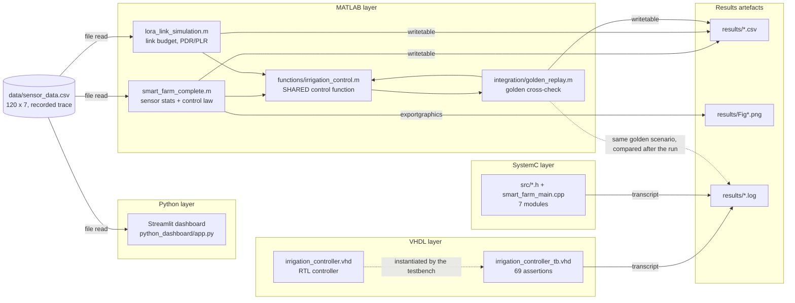
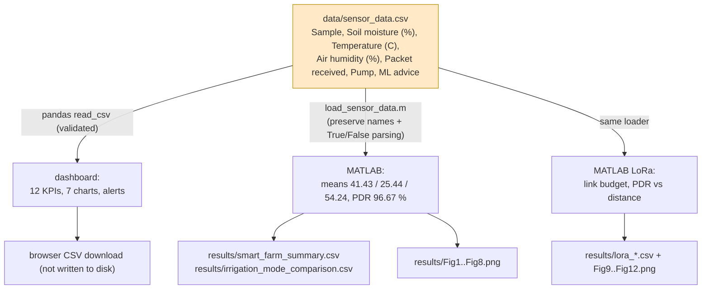
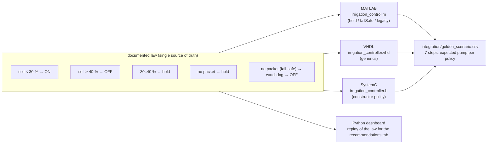
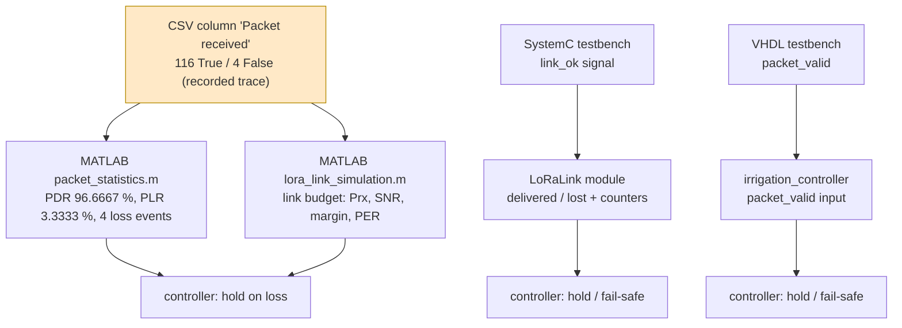

# INTEGRATION REPORT — Smart Farm system

**Project:** Smart Farm Monitoring and Automated Irrigation System
**Scope of this report:** how the seven components of the project are actually connected, what they share,
what they do **not** share, and the evidence collected by executing them together.
**Date:** 2026-11-08 · **Host:** macOS 26.7 (x86_64, Intel) · **Run log:** `results/integration_report.txt`

---

## 0. The claim this report does and does not make

> **What IS connected (real interfaces):**
> * `data/sensor_data.csv` is **read from disk** by the Python dashboard, by the MATLAB analysis script and by the
>   MATLAB LoRa script. That is a genuine, verifiable data interface.
> * The MATLAB scripts **write real files** into `results/` (`*.csv`, `*.png`), which are the project's reported
>   artefacts.
> * The GHDL and SystemC simulations produce **real transcript files** that the integration check parses.
> * All four implementations of the irrigation law are exercised against **one shared golden scenario**
>   (`integration/golden_scenario.csv`) and their results agree (see §5).
>
> **What is NOT connected:**
> * The VHDL/GHDL simulation, the SystemC simulation and the MATLAB analysis **do not exchange data** with each
>   other at run time. There is no co-simulation, no shared memory, no socket, no DPI/VHPI bridge.
> * No component drives real hardware: no sensor, no LoRa radio, no pump, no FPGA.
> * The MATLAB/SystemC/VHDL "link" is a **software model**; the packet flags in the CSV are a recorded trace,
>   not a measurement.
>
> Everything below distinguishes those two situations explicitly.

---

## 1. System architecture



**Reading the diagram:** solid arrows between the CSV/dashboard/MATLAB block are real file interfaces.
The dotted arrow links the golden scenario to the *transcripts* only through the integration script: the
simulations never talk to each other; a Python script compares their recorded outputs afterwards.

---

## 2. Component connections — what is real and what is independent

| # | Component | Reads (real file I/O) | Writes (real file I/O) | Runtime link to other components |
|---|---|---|---|---|
| 1 | **Sensor dataset** `data/sensor_data.csv` | — | — | **input artefact only**; nothing in the project regenerates it (gap D-01) |
| 2 | **Python dashboard** `python_dashboard/app.py` | `data/sensor_data.csv` | CSV download in the browser only | reads the same file as MATLAB; no direct link |
| 3 | **MATLAB analysis** `matlab/smart_farm_complete.m` | `data/sensor_data.csv` | `results/smart_farm_summary.csv`, `irrigation_mode_comparison.csv`, `packet_loss_events.csv`, `Fig1…Fig8.png` | calls `irrigation_control.m`, `packet_statistics.m`, `load_sensor_data.m` |
| 4 | **LoRa simulation** `matlab/lora_link_simulation.m` | `data/sensor_data.csv` | `results/lora_config.csv`, `lora_scenarios.csv`, `lora_distance_sweep.csv`, `lora_link_trace.csv`, `lora_controller_comparison.csv`, `Fig9…Fig12.png` | same controller function as (3) |
| 5 | **VHDL controller** `vhdl/irrigation_controller.vhd` | **none** | **none** | **independent simulation** — stimulus is generated inside the testbench |
| 6 | **GHDL verification** `vhdl/run_ghdl.sh` | the two `.vhd` files | `results/vhdl_simulation.log` | none (standalone) |
| 7 | **SystemC simulation** `systemc/` | **none** | `results/systemc_simulation.log` | **independent simulation** — scenario is compiled into `smart_farm_types.h` |

**Conclusion:** there are exactly **three real data interfaces** in the project:
`CSV → dashboard`, `CSV → MATLAB`, and `component → results/`. Everything else is a comparison performed
*after the fact* by `integration/integration_check.py`, which parses the transcripts.

---

## 3. Data flow



Verification of the interface (executed, see §6 I-01/I-02):
the CSV header is **exactly** the 7 expected columns in order; the 6 column names used by the dashboard and the
7 keys used by the MATLAB loader all resolve against that header; `Packet received` uses only `True`/`False` and
`Pump` only `ON`/`OFF`.

---

## 4. Control flow — one law, four implementations

The irrigation decision is the part of the project that is intentionally replicated. The law itself lives in the
project documentation (report §5) and, as data, in `integration/golden_scenario.csv`.



Configuration extracted programmatically from each source (I-03):

| Component | File | Dry threshold | Wet threshold | On lost packet |
|---|---|---|---|---|
| MATLAB | `matlab/functions/irrigation_control.m` | **30** | **40** | hold, watchdog after **3** |
| VHDL | `vhdl/irrigation_controller.vhd` | **30** | **40** | hold (`FAILSAFE_ON_LOSS=false`), fail-safe = OFF on first loss |
| SystemC | `systemc/src/smart_farm_types.h` | **30** | **40** | hold, watchdog after **3** |
| Python dashboard | `python_dashboard/app.py` | **30** | **40** | hold (no fail-safe mode) |

**Verdict:** the thresholds are identical in all four implementations and the "hold on loss" rule is implemented
everywhere. The **fail-safe mechanism differs by design** — VHDL switches off on the first missing packet, while
MATLAB/SystemC wait for a 3-packet watchdog — so the fail-safe behaviour is *not* identical across components.
This is a documented, deliberate difference (see `VHDL_TEST_REPORT.md` §10), not a defect discovered now.

### Duplication that was removed / avoided

* The MATLAB LoRa script and the MATLAB analysis script **share** `irrigation_control.m` and `packet_statistics.m`
  instead of re-implementing them.
* `matlab/smarf.m` is a thin wrapper, not a second copy of the analysis.
* The integration work adds **no new control-law implementation**: the golden replay *calls* the existing MATLAB
  function, and the checker compares outputs — it does not re-implement the algorithm.
* Remaining duplication (not removed on purpose, because each is required by its language): the law exists in
  MATLAB, VHDL, SystemC and (for the recommendation tab) Python. `integration/integration_check.py` is what keeps
  them honest.

---

## 5. Communication flow (simulated LoRa)



| Communication aspect | Where it is modelled | Evidence |
|---|---|---|
| packet delivery statistics | MATLAB `packet_statistics.m` (on the CSV trace) | PDR 96.6667 %, PLR 3.3333 % (`results/smart_farm_summary.csv`) |
| radio physics (airtime, path loss, SNR, PER) | MATLAB `lora_*.m` | `LORA_SIMULATION.md`, 15/15 checks |
| packet loss at system level | SystemC `LoRaLink` (scripted outages) | `results/systemc_simulation.log` |
| loss → controller input | VHDL `packet_valid`, SystemC `packet_ready` | transcripts |

**Communication failure → intended safe pump state (verified, §6 I-05):**

| Situation | MATLAB hold | MATLAB fail-safe | SystemC hold | SystemC fail-safe | VHDL hold | VHDL fail-safe |
|---|---|---|---|---|---|---|
| outage starts with pump **OFF** | OFF (held) | OFF | OFF | OFF | OFF | OFF |
| outage starts with pump **ON** | **ON (held)** | **OFF (watchdog)** | **ON (held)** | **OFF (watchdog)** | **ON (held)** | **OFF** |

No implementation ever switches the pump **ON** as a reaction to missing data, and every fail-safe path ends in
the OFF state — which is the defined safe state of the system.


---

## 6. Integration test cases and actual results

All of the following was executed on this machine by `integration/run_integration.sh`; the complete log is
`results/integration_report.txt` (793 lines).

### 6.1 Cross-component checks (`integration/integration_check.py`, 34 checks)

| ID | Test case | Expected | **Result** |
|---|---|---|---|
| I-01 | CSV file exists, header = 7 exact columns in order | match | ✅ header identical |
| I-01 | 120 data rows | 120 | ✅ 120 |
| I-01 | sensor columns parse as numbers; `Sample` as integer | yes | ✅ |
| I-01 | `Packet received` only `True`/`False`; `Pump` only `ON`/`OFF` | yes | ✅ `['False','True']`, `['OFF','ON']` |
| I-01 | soil/humidity within 0…100 %, temperature within −20…60 °C | yes | ✅ 13.94…62.82 %, 39.73…75.34 %, 18.53…30.61 °C |
| I-02 | every dashboard `COLUMN_MAP` key exists in the CSV header | yes | ✅ 6/6 |
| I-02 | every MATLAB loader key resolves against the header | yes | ✅ 7/7 |
| I-03 | dry threshold identical in all four implementations | 30 | ✅ `[30]` |
| I-03 | wet threshold identical in all four implementations | 40 | ✅ `[40]` |
| I-03 | every implementation holds the state on a lost packet | yes | ✅ 4/4 |
| I-03 | the two watchdog implementations use the same limit | 3 | ✅ MATLAB 3 = SystemC 3 |
| I-04 | MATLAB reproduces the golden scenario (hold + fail-safe) | 7/7 | ✅ 7/7 |
| I-04 | SystemC reproduces the golden scenario | 7/7 | ✅ 7/7 |
| I-04 | VHDL reproduces the golden scenario on the mapped cases | 7/7 | ✅ 7/7 |
| I-05 | pump OFF during the outage that starts with the pump OFF | OFF | ✅ all three simulators |
| I-05 | hold keeps irrigating / watchdog forces OFF in the outage that starts ON | 1 / 0 | ✅ all three simulators |
| I-06 | result artefacts exist (7 files) | exist | ✅ 7/7 |
| I-06 | dataset is read by dashboard and MATLAB | yes | ✅ |
| I-06 | no component regenerates the dataset (known gap) | none | ✅ none |

### 6.2 The golden scenario — the central integration evidence

The same 7-step stimulus (each step held 8 cycles) was applied to three independent simulators:

| Step | Scenario | Expected hold / fail-safe | MATLAB | SystemC | VHDL |
|---|---|---|---|---|---|
| 1 | dry soil 20 %, telemetry OK | 1 / 1 | ✅ 1/1 | ✅ 1/1 | ✅ 1/1 |
| 2 | normal soil 35 % (band) | 1 / 1 | ✅ 1/1 | ✅ 1/1 | ✅ 1/1 |
| 3 | wet soil 45 % | 0 / 0 | ✅ 0/0 | ✅ 0/0 | ✅ 0/0 |
| 4 | comms failure while pump OFF | 0 / 0 | ✅ 0/0 | ✅ 0/0 | ✅ 0/0 |
| 5 | telemetry restored, dry 25 % | 1 / 1 | ✅ 1/1 | ✅ 1/1 | ✅ 1/1 |
| 6 | comms failure while pump ON | 1 / 0 | ✅ 1/0 | ✅ 1/0 | ✅ 1/0 |
| 7 | telemetry restored, still dry | 1 / 1 | ✅ 1/1 | ✅ 1/1 | ✅ 1/1 |

**21 of 21 (7 steps × 3 simulators) match the specification.**

### 6.3 Component suites executed inside the integration run

| Step | Component | Command | Result |
|---|---|---|---|
| 1 | integration checks (pre-run) | `python3 integration/integration_check.py` | **34/34 PASS** |
| 2 | MATLAB analysis | `matlab -batch run('matlab/smart_farm_complete.m')` | **22/22 checks PASS** |
| 3 | MATLAB LoRa simulation | `matlab -batch run('matlab/lora_link_simulation.m')` | **15/15 checks PASS** |
| 4 | MATLAB golden replay | `matlab -batch run('integration/golden_replay.m')` | **7/7 steps PASS** |
| 5 | Python dashboard | `.venv/bin/python python_dashboard/tests/run_tests.py` | **13/13 PASS** |
| 6 | VHDL + GHDL | `vhdl/run_ghdl.sh` | **69/69 assertions PASS**, `simulation finished @256ns with status 0` |
| 7 | SystemC | `systemc/run_systemc.sh` | **14/14 checks PASS**, exit 0 |
| 8 | integration checks (post-run) | `python3 integration/integration_check.py` | **34/34 PASS** |

```
ALL 8 STEPS PASSED
```

Total assertions executed by the integrated system: **34 + 22 + 15 + 7 + 13 + 69 + 14 + 34 = 208**, 0 failures.

### 6.4 One modelling difference worth knowing

MATLAB reports `hold ON 40 samples / fail-safe ON 34 samples`, SystemC reports `hold 39 / fail-safe 33` controller
cycles. The one-cycle difference is the **registered pipeline** in the SystemC model (sensor → link → processor →
controller → actuator), which the zero-delay MATLAB algorithm does not have. The *decisions* are identical; only
the latency accounting differs. This is expected and is not an integration defect.


---

## 7. Missing interfaces (identified, not invented)

| # | Missing interface | Consequence today | Recommended fix |
|---|---|---|---|
| M-1 | **No producer for `data/sensor_data.csv`** | the dataset cannot be regenerated; its provenance is unknown (`DATA_ANALYSIS.md` finding D-01) | add `python_dashboard/data_generator.py` that writes the CSV deterministically from the documented parameters |
| M-2 | **No shared parameter file** (thresholds / watchdog / seed) | each language holds its own copy of 30/40/3 → they agree *today* but can drift silently | add `config/params.json` and load it from MATLAB, Python, VHDL (via generic defaults in a generated package) and SystemC |
| M-3 | **VHDL and SystemC do not consume the dataset** | they run on internal scenarios, so they cannot reproduce a recorded field run | optional: generate a VHDL/SystemC stimulus package from the CSV (e.g. a `.vhd` constant array or a `scenario.csv`) |
| M-4 | **No co-simulation bridge** (VHPI/DPI) | MATLAB cannot drive the VHDL or SystemC models within one run | only needed if the supervisor asks for hardware/software co-simulation; today the golden-scenario comparison covers the functional equivalence |
| M-5 | **No machine-readable architecture description** | the diagram lives in this markdown file | keep it here; the Mermaid source is version-controlled with the report |
| M-6 | **Results are not consumed by any component** | `results/*.csv` are final artefacts; the dashboard does not display them | optional: let the dashboard load `results/smart_farm_summary.csv` |

---

## 8. Remaining limitations

1. **No physical connection anywhere.** The three simulators share a *stimulus definition*, not a runtime link;
   the comparison in §6.2 is performed by a script that reads their transcripts afterwards.
2. **Golden scenario covers the control law, not the full stack.** It compares the irrigation decision (7 cases),
   not the sensor pipeline, the radio model or the dashboard rendering.
3. **Fail-safe semantics differ** (VHDL immediate OFF vs MATLAB/SystemC watchdog of 3). Steady-state results agree
   on the tested cases, but a 1–2 packet outage produces a different transient. One law must be chosen before the
   final report (already flagged in `VHDL_TEST_REPORT.md`).
4. **The dataset is a frozen trace**, and the MATLAB replay of the documented law agrees with its `Pump` column on
   120/120 samples — but the CSV `Pump` column was *produced* by the same law, so this is consistency, not
   independent validation.
5. **Cycle-vs-sample granularity**: MATLAB counts samples, SystemC counts clock cycles (5-stage pipeline), VHDL
   counts single-cycle steps. Comparisons are made on steady-state values, not on timestamps.
6. **No timing/performance integration**: the aerial transmission time (46 ms … 1.2 s per packet) modelled in
   `LORA_SIMULATION.md` is not represented in the SystemC timing, which uses 1 s per sample.
7. **Windows/Linux were not tested**; the integration run was executed on macOS Intel only.
8. **`VSCode-darwin-x64.dmg` (304 MB)** still sits in the repository root and is excluded from git — unrelated to
   the system, but it should be removed from the deliverable folder.

---

## 9. How to reproduce the whole run

```bash
cd /Users/gtx-z/Downloads/SmartFarm_Simulation_English
./integration/run_integration.sh          # ~2-3 minutes (3 MATLAB starts)
echo $?                                   # 0 = all 8 steps passed
less results/integration_report.txt       # full log
```

Individual pieces:

```bash
python3 integration/integration_check.py                       # 34 cross-component checks
matlab -batch "run('integration/golden_replay.m')"             # MATLAB vs golden scenario
./vhdl/run_ghdl.sh                                             # 69 VHDL assertions
./systemc/run_systemc.sh                                       # 14 SystemC checks
.venv/bin/python python_dashboard/tests/run_tests.py           # 13 dashboard checks
```

---

## 10. Summary

| Question | Answer |
|---|---|
| How do the components exchange data? | **Three real file interfaces**: `CSV → dashboard`, `CSV → MATLAB`, `component → results/`. Nothing else is connected at run time. |
| Which components are independent? | **VHDL/GHDL** and **SystemC** are standalone simulations (internal stimulus, no project data input). |
| Are the column names and types consistent? | **Yes** — verified against the real header (7 columns, `True`/`False`, `ON`/`OFF`), and both consumers resolve all keys. |
| Is the irrigation logic consistent? | **Thresholds: yes (30/40 in all four). Hold-on-loss: yes (all four). Fail-safe: no — by design, VHDL is immediate, MATLAB/SystemC use a 3-packet watchdog.** |
| Does communication failure lead to the safe state? | **Yes** — verified in all three simulators: the pump is never switched ON by missing data, and the fail-safe path ends OFF. |
| Is logic duplicated? | The law exists in four languages (unavoidable here), but the MATLAB-side duplication was removed (shared function) and the integration adds **no fifth implementation** — the golden expectations are data. |
| Integration scripts added | `integration/integration_check.py`, `integration/golden_replay.m`, `integration/golden_scenario.csv`, `integration/run_integration.sh` — and nothing else. |
| Any file overwritten or deleted? | **No.** All project files were preserved; the integration folder and this report are additions. |
| Are separate simulations physically connected? | **No, and this report does not claim they are.** |

