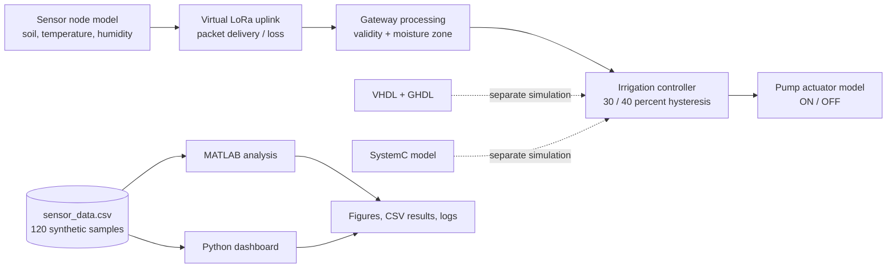
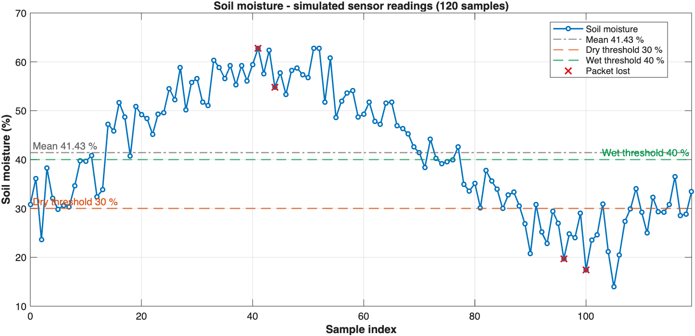
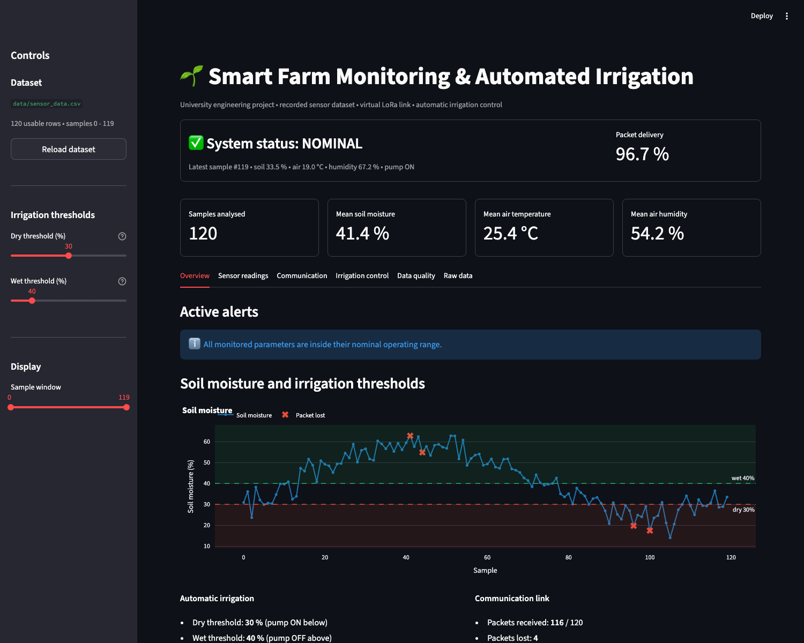
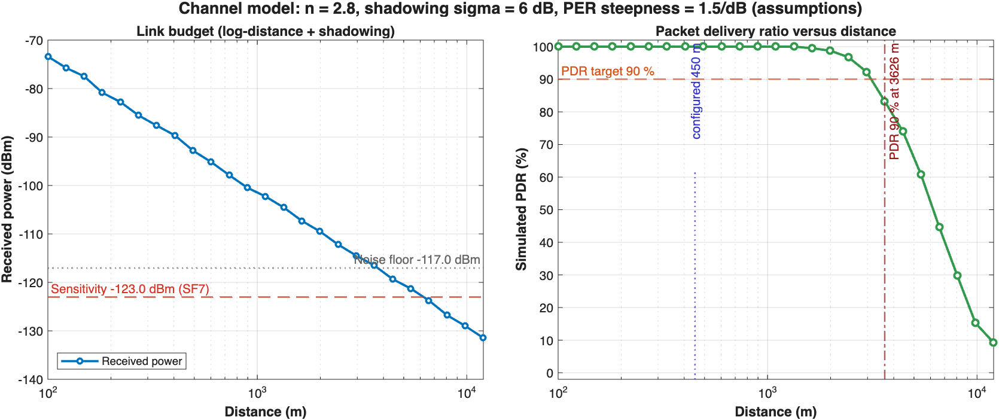
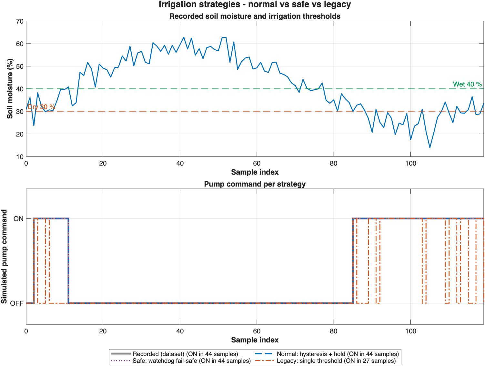
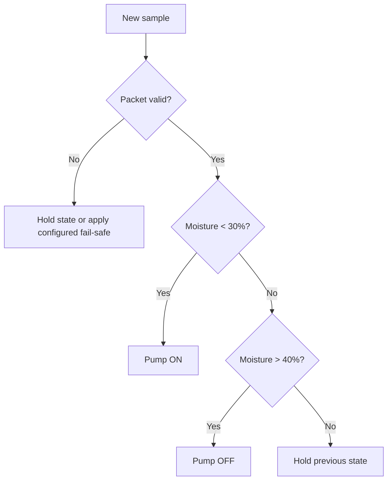

# Smart Farm Monitoring and Automated Irrigation
## Graduation Project Defense Presentation

**Project title:** Smart Farm Monitoring and Automated Irrigation System Using IoT, LoRa, MATLAB, Python, VHDL, and SystemC  
**Format:** 18 slides | **Audience:** University graduation project defense  
**Presenter:** [Student name] | **Supervisor:** [Supervisor name] | **Institution:** [University] | **Date:** [Defense date]

### Presentation design notes
- Use a 16:9 layout with an engineering editorial style: deep green, warm white, charcoal, and restrained signal-orange accents.
- Keep titles concise and use one main visual per slide. Use the linked project figures and dashboard screenshot rather than decorative stock imagery.
- Treat every dataset value as synthetic or recorded-from-simulation. Radio values are model estimates, not field measurements.
- Suggested timing: about 12-15 minutes, plus questions.

---

## Slide 1 - Title

**Smart Farm Monitoring and Automated Irrigation**  
*Using IoT, LoRa, MATLAB, Python, VHDL, and SystemC*

University Graduation Project Defense  
[Student name] | [Programme / department] | [Supervisor] | [Date]

**Visual:** Full-width crop of [soil moisture plot](results/Fig1_soil_moisture.png) or [dashboard overview](results/Fig13_dashboard_overview.png), with a dark translucent title panel. Add university logo only if approved.

**Speaker notes:**  
Good morning/afternoon. My project explores how sensing, long-range communication, monitoring, and irrigation control can be brought together in a smart-farm system. I will focus on what was implemented and tested in software, and I will distinguish those results from anything that would require real farm hardware.

---

## Slide 2 - Project Introduction

**A connected control concept, evaluated as a software prototype**

- Monitor soil moisture, air temperature, and relative humidity.
- Send sample packets over a modeled LoRa uplink.
- Use received moisture data to make a pump ON/OFF decision.
- Inspect behavior through a Python dashboard and engineering simulations.

**Scope:** No sensor, radio, pump, relay, gateway, or FPGA board was physically connected.

**Visual:** Simple four-stage flow: **Sensor model -> LoRa link model -> Irrigation controller -> Dashboard / actuator model**.

**Speaker notes:**  
The motivation is to connect an agricultural use case to several engineering disciplines. A sensor node and pump are represented by software models. LoRa is modeled at packet and link-budget level, while MATLAB, Python, VHDL, and SystemC provide different analysis and implementation views. This is not a deployed IoT product or a field trial.

---

## Slide 3 - Problem Statement

**Three engineering challenges**

1. **Noisy measurements:** a single threshold can cause rapid pump switching near the decision boundary.
2. **Lost telemetry:** the controller must define what to do when a fresh sample is unavailable.
3. **Trustworthy evidence:** plots alone do not prove that the implemented controller follows its specification.

**Design question:** How can sensing, communication failure, irrigation logic, and verification be represented and checked in a reproducible software prototype?

**Visual:** Three compact problem icons or blocks: signal variation, missing packet, test/verification.

**Speaker notes:**  
These are the central problems addressed by the project. Hysteresis provides a way to reduce switching caused by small variations. A lost packet creates a safety-policy decision: hold the previous command or force the pump off after a defined condition. Finally, each implementation needs checks that compare its outputs with expected behavior.

---

## Slide 4 - Project Objectives

- Create a synthetic sensor-data workflow for soil moisture, temperature, and humidity.
- Model packet reception and LoRa link behavior under documented assumptions.
- Implement a monitoring and exploration interface in Python / Streamlit.
- Implement and compare irrigation control behavior, including hysteresis.
- Represent the controller in VHDL and the system in SystemC.
- Verify software behavior with recorded checks and a shared golden scenario.

**Success criterion:** reproducible, traceable software evidence, not a claim of field performance.

**Speaker notes:**  
The objectives span the full conceptual chain, from sample generation and communication modeling to control, visualization, and verification. The boundary of success is important: this work demonstrates and checks models. It does not establish sensor accuracy, radio range, or water savings in a real field.

---

## Slide 5 - System Architecture

**Important boundary:** the CSV feeds analysis and dashboard workflows; VHDL and SystemC are separate simulations. They are compared through a golden scenario, not connected in live co-simulation.

**Speaker notes:**  
This diagram shows the intended system flow and the actual software evidence paths. The sensor, link, gateway, and actuator are modeled. The CSV is an input artifact for the Python and MATLAB analysis paths. VHDL and SystemC run separately and are cross-checked against the same golden scenario; the languages do not exchange data at runtime.

---

## Slide 6 - System Components

| Component | Role in the project | Evidence / boundary |
|---|---|---|
| Sensor dataset | 120-row sample trace | Synthetic; no physical sensor acquisition |
| Python / Streamlit | Monitoring, charts, controls, data exploration | Dashboard screenshot and project test report |
| MATLAB | Statistics, irrigation replay, LoRa link-budget analysis | Exported CSVs and figures |
| LoRa model | Airtime, path loss, link margin, packet-error model | Assumption-driven; not measured RF |
| VHDL / GHDL | RTL irrigation controller and simulation | Functional checks; no FPGA deployment |
| SystemC | Clocked system-level model | Scenario simulation; no physical hardware |

**Visual:** A six-item component map. Keep this table readable; avoid adding implementation details not shown here.

**Speaker notes:**  
Each technology has a distinct role. Python is the user-facing analysis layer, MATLAB handles numerical analysis and link modeling, VHDL expresses a hardware-oriented controller, and SystemC models system-level timing and module interaction. The sensor data is synthetic, and all actuator behavior is represented in software.

---

## Slide 7 - Sensor Data

**120 samples | 3 synthetic environmental signals | 4 recorded packet losses**

- Soil moisture: **41.43% mean**, range **13.94-62.82%**.
- Air temperature: **25.44 C mean**, range **18.53-30.61 C**.
- Relative humidity: **54.24% mean**, range **39.73-75.34%**.
- Dataset schema and values passed file-level integrity checks; the source trace is not regenerated by the current project.

**Visual:** 

**Caption:** Soil moisture is synthetic; dashed thresholds indicate the 30% dry and 40% wet boundaries used by hysteresis control.

**Speaker notes:**  
The dataset contains 120 samples from sample index 0 through 119. The averages and ranges shown here come from the project analysis. The trace is synthetic rather than physically measured. Its current provenance is a limitation: the CSV is used as an input artifact, but the current code does not reproduce that exact file.

---

## Slide 8 - Python Dashboard

**A user-facing view of the project data and model outputs**

- Streamlit interface for exploring the sensor trace and system behavior.
- Displays environmental trends, packet reception, irrigation state, and summary indicators.
- Supports interactive exploration and CSV download.
- Dashboard output is a monitoring aid, not a validated farm decision service.

**Visual:** 

**Optional inset:** [irrigation view](results/Fig14_dashboard_irrigation.png).

**Speaker notes:**  
The dashboard brings the data and the control story into one place. It helps a reviewer see changing sensor values, communication outcomes, and the derived pump state. The displayed values are synthetic or model-derived. The dashboard should not be interpreted as a cloud-connected deployment or as advice validated against crop-specific agronomy.

---

## Slide 9 - LoRa Communication Model

**Link behavior is simulated from explicit assumptions**

- Link budget: path loss and shadowing -> received power -> SNR / margin -> packet error probability.
- Example configuration: EU868 assumption, 868.1 MHz, SF7, 125 kHz bandwidth, 14 dBm transmit power, 16-byte payload.
- At SF7, modeled airtime is **46.336 ms** per packet.
- Recorded trace: **116 / 120 delivered (96.67% PDR)**. Nominal 450 m link-budget scenario: **120 / 120** in this seeded run.

**Visual:** 

**Caption:** Model estimate under documented parameters; not a measured radio range. PDR can vary by scenario and random seed.

**Speaker notes:**  
The project includes both a packet-reception trace and a more explicit link-budget model. The recorded dataset has four losses in 120 packets. Separately, under the nominal 450 meter configuration and fixed seed, the simulated link model delivered all 120 packets. These are different evidence sources, and neither is a radio measurement. The link model depends on assumptions such as path-loss exponent, shadowing, and packet-error transition.

---

## Slide 10 - MATLAB Simulation and Analysis

**MATLAB connects the data trace to quantitative analysis**

- Loads and validates the CSV, computes sensor statistics, and replays irrigation logic.
- Computes packet delivery / loss statistics and outage behavior.
- Compares hysteresis with a legacy single-threshold rule.
- MATLAB analysis reports **22 self-checks**; the summary CSV is the source for key dataset metrics.

**Key comparison:** Hysteresis matched the recorded pump state on **120 / 120 samples**; the single-threshold comparison matched **103 / 120 (85.83%)** and produced **18 transitions** versus 3.

**Visual:** 

**Speaker notes:**  
MATLAB is used for repeatable analysis of the dataset and for the LoRa link-budget model. On this dataset, the hysteresis replay agrees with all recorded pump states, while the legacy single-threshold method disagrees on 17 samples and creates more switching. This is a result on this synthetic trace, not evidence that the controller is optimal for a crop or field.

---

## Slide 11 - Automatic Irrigation Algorithm

**Two thresholds create a hysteresis band**

| Input condition | Hysteresis controller action |
|---|---|
| Valid moisture < 30% | Pump ON |
| Valid moisture > 40% | Pump OFF |
| 30%-40% inclusive | Keep previous pump state |
| Packet missing | Hold previous state; fail-safe policies may force OFF |

**Design note:** the fail-safe policy differs by implementation: MATLAB / SystemC use a 3-loss watchdog; VHDL offers immediate OFF on loss as a configuration; Python dashboard replay holds state.

**Speaker notes:**  
Hysteresis avoids changing state every time moisture moves around one threshold. The pump turns on below 30 percent and turns off only above 40 percent; between those values the prior state is retained. Missing communication is a separate policy choice. The implementations support different fail-safe behavior, so the exact configuration must be stated when comparing results.

---

## Slide 12 - VHDL Controller

**A synthesizable-style RTL representation of the irrigation decision**

- Clocked controller with reset, packet-valid input, moisture input, and pump-enable output.
- Configurable thresholds and behavior options are represented through VHDL generics.
- Includes range handling for invalid moisture values.
- Tested as RTL in simulation; **not loaded onto an FPGA**.

**Visual:** Minimal block diagram of inputs -> controller state / threshold logic -> pump output. Add a short VHDL code excerpt only if it remains legible.

**Speaker notes:**  
The VHDL module isolates the control decision in a hardware-oriented description. The interface accepts a sample and validity signal and emits a pump command. GHDL confirms that the RTL can be analyzed, elaborated, and simulated, but that is not equivalent to FPGA synthesis timing closure or board operation.

---

## Slide 13 - GHDL Verification

**Functional verification, not physical hardware testing**

- GHDL 5.1.1 with VHDL-2008.
- Testbench exercises reset, dry / band / wet values, exact threshold boundaries, packet loss, invalid values, and recovery.
- **69 assertions passed; 0 failed** in the recorded VHDL test run.
- GHDL analysis, elaboration, simulation, and an RTL synthesis check completed.

**Visual:** Use a cropped excerpt from `results/vhdl_simulation.log` showing the final check count and PASS verdict; do not show a full terminal screenshot.

**Speaker notes:**  
The testbench uses multiple controller configurations and checks expected outputs across ordinary and edge cases. The recorded report gives 69 passing assertions and no failures. This establishes functional behavior within the simulated test cases. It does not validate analog sensors, a physical pump driver, or FPGA board integration.

---

## Slide 14 - SystemC Simulation

**System-level timing and module interaction**

- Models sensor sampling, packet delivery, data validity, controller behavior, and pump state.
- Runs a scripted seven-step scenario, including communication loss while the pump is ON and OFF.
- Recorded run summary: **14 checks passed, 0 failed**.
- Scenario totals: 57 sensor samples; 55 packets sent, 39 delivered, and 16 lost.

**Visual:** A simplified module chain: SensorMonitor -> LoRaLink -> SoilMoistureProcessor -> IrrigationController -> PumpActuator.

**Speaker notes:**  
SystemC adds a clocked, system-level view. The scripted scenario includes both normal readings and outages so that the controller policies can be observed over time. In the recorded run, 14 checks passed. The packet counts belong to this particular deterministic scenario; they are not the same as the 120-row CSV trace or the MATLAB nominal link run.

---

## Slide 15 - Results and Analysis

**Evidence from separate models and shared test cases**

| Result | Observed value | Evidence type |
|---|---:|---|
| Dataset packet delivery | 96.67% (116 / 120) | Synthetic recorded trace |
| Hysteresis agreement with recorded pump | 100% (120 / 120) | MATLAB replay |
| Legacy single-threshold agreement | 85.83% (103 / 120) | MATLAB comparison |
| GHDL controller checks | 69 / 69 pass | RTL functional simulation |
| SystemC checks | 14 / 14 pass | System-level simulation |
| Integration checker | 34 / 34 pass | File, interface, and golden-scenario checks |

**Takeaway:** multiple models reproduce expected behavior under defined scenarios; results do not establish field-level accuracy or water savings.

**Visual:** Compact scorecard with four accent metrics: **96.67% PDR**, **120/120 replay**, **69/69 GHDL**, **14/14 SystemC**. Use explicit captions for evidence type.

**Speaker notes:**  
This slide summarizes results while keeping their source visible. The 96.67 percent PDR comes from the CSV trace. The controller agreement comes from replaying the recorded pump column. GHDL and SystemC counts refer to their own simulation checks, and the integration checker validates file-level interfaces and mapped golden-scenario cases. These numbers must not be added together as one universal test count because the suites cover different things.

---

## Slide 16 - Limitations and Future Work

**Current limitations**

- No physical sensors, LoRa modules, gateway, pump, relay, or FPGA board.
- Dataset is synthetic and its exact generation path is not reproducible from the current code.
- LoRa channel parameters are assumptions; no RF calibration or field range test.
- No live co-simulation between MATLAB, VHDL, and SystemC.
- Fail-safe behavior is not identical across implementations; ML advice is demonstrative only.

**Next steps**

1. Regenerate and version a documented dataset, or collect labeled measurements.
2. Align the fail-safe policy and shared test vectors across implementations.
3. Prototype with calibrated sensors, a protected pump driver, and LoRa hardware.
4. Measure packet delivery, energy, control response, and crop-specific outcomes in a field trial.

**Speaker notes:**  
The limitations define what should happen next. A physical prototype would require safe actuator isolation, calibrated sensors, and measured RF behavior. Before that, the software models should share a reproducible dataset and a single explicit policy for communication failure. Machine-learning output should remain a demonstration until it is evaluated on representative, labeled agricultural data.

---

## Slide 17 - Conclusion

- The project implements a software model of monitoring, packet communication, irrigation control, visualization, and hardware-oriented design.
- Hysteresis reduced switching in the recorded synthetic trace and matched its pump-state column.
- GHDL, SystemC, MATLAB, and integration checks provide executable evidence for selected scenarios.
- The work is a verified **simulation prototype**, not a physically deployed smart farm.

**Closing statement:** The next engineering milestone is to connect reproducible software evidence to safe, measured hardware experiments.

**Speaker notes:**  
In conclusion, the project demonstrates how several engineering technologies can contribute to one smart-farm concept. Its strongest result is a reproducible software workflow with explicit checks and clear boundaries. The next step is not to claim deployment, but to validate the models against measured hardware and field data.

---

## Slide 18 - Thank You

# Thank you

**Questions and discussion**

[Student name] | [Email or project repository, if appropriate]

**Visual:** Clean closing slide using a small crop of the dashboard or soil-moisture chart. Keep the question prompt prominent and avoid adding unsupported claims.

**Speaker notes:**  
Thank you for your attention. I would be happy to discuss the control policy, the link-budget assumptions, the verification approach, or the steps required to move from this software prototype toward a physical demonstration.

---

## Source Artifacts

- Dataset and statistics: `data/sensor_data.csv`, `DATA_ANALYSIS.md`, `results/smart_farm_summary.csv`
- Dashboard visuals: `results/Fig13_dashboard_overview.png`, `results/Fig14_dashboard_irrigation.png`
- MATLAB figures and outputs: `results/Fig1_soil_moisture.png`, `results/Fig4_pump_timeline.png`, `results/Fig7_irrigation_comparison.png`
- LoRa model and figures: `LORA_SIMULATION.md`, `results/Fig10_link_budget_vs_distance.png`, `results/lora_scenarios.csv`
- VHDL / GHDL: `VHDL_TEST_REPORT.md`, `results/vhdl_simulation.log`
- SystemC: `SYSTEMC_TEST_REPORT.md`, `results/systemc_simulation.log`
- Integration: `INTEGRATION_REPORT.md`, `results/integration_report.txt`
