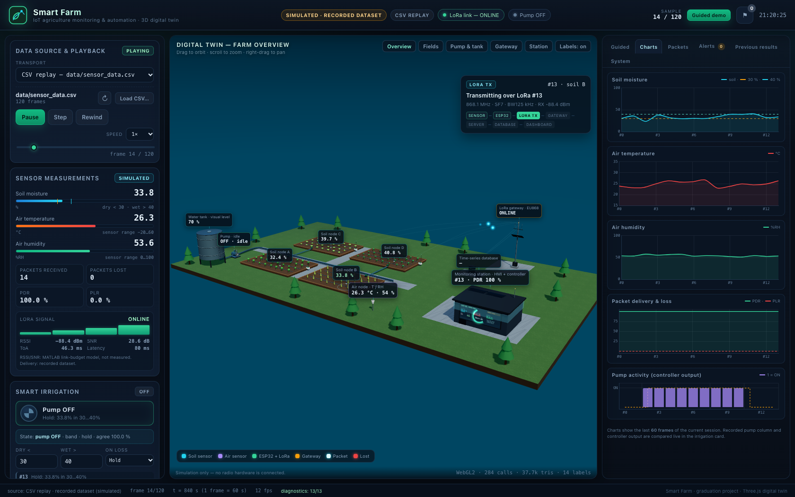

# Smart Farm Simulation (No Hardware Required)

This is a **software-only simulation** of a smart agriculture system using a virtual LoRa communication link. It does not perform real radio transmission.

## Included
- `matlab/smart_farm_simulation.m`: synthetic soil/air sensor data, virtual packet delivery/loss, irrigation control and plots.
- `vhdl/irrigation_controller.vhd`: synthesizable-style RTL description of a digital irrigation controller.
- `systemc/smart_farm_systemc.cpp`: simplified clocked SystemC model.
- `python_dashboard/app.py`: interactive Streamlit dashboard, virtual LoRa metrics, synthetic sensor data and an illustrative ML classifier.

## Software
1. MATLAB (or GNU Octave, subject to minor compatibility differences).
2. A VHDL simulator such as GHDL.
3. SystemC and a C++ compiler.
4. Python 3.10+.

No ESP32, Arduino, sensors, pump or LoRa radio modules are required for this simulation.

## Run the dashboard
Open a terminal in `python_dashboard`:
```bash
pip install -r requirements.txt
streamlit run app.py
```

## Run MATLAB
Open `matlab/smart_farm_simulation.m` in MATLAB and press Run.

## Analyze VHDL with GHDL
```bash
ghdl -a --std=08 vhdl/irrigation_controller.vhd
ghdl -e --std=08 irrigation_controller
```
This analyzes and elaborates the design. A dedicated testbench should be added for full signal-level verification.

## Build SystemC
Set `SYSTEMC_HOME` to your SystemC installation. A typical Linux command is:
```bash
g++ -I$SYSTEMC_HOME/include -L$SYSTEMC_HOME/lib-linux64 systemc/smart_farm_systemc.cpp -lsystemc -o smart_farm_systemc
./smart_farm_systemc
```
Library folder names vary by installation and operating system.

## Important limitations
- Sensor values are generated synthetically, not measured from real sensors.
- LoRa is represented by a software packet model. There is no RF transmission.
- RSSI/SNR values are illustrative estimates, not measured radio values.
- The ML example is trained on synthetic data and is for demonstration only.
- Real LoRa range, energy consumption and field performance cannot be validated without physical hardware.

## 3D dashboard (Three.js) — added
A complete interactive digital twin lives in `web3d/`:

```bash
./web3d/run_web.sh        # serves the project on http://localhost:8080/web3d/
```



It replays the same `data/sensor_data.csv`, joins the MATLAB link-budget trace
(`results/lora_link_trace.csv`), animates the LoRa packets through a 3D farm,
runs the documented irrigation law (100 % agreement with the recorded pump
column) and provides Chart.js history, alerts, packet logs and self-diagnostics.
It does **not** replace or regenerate the MATLAB/VHDL/SystemC results; the
“Previous results” tab links to them.

A **Guided presentation mode** adds a ten-stage, event-synchronised explanation
panel (English content + Arabic presenter notes), presentation controls
(Start / Next / Previous / Pause / Resume / Restart / Auto play), 3D component
highlighting and clickable technical explanations for sensors, ESP32 nodes,
gateway, server, database, pump, tank and station.

See `web3d/README.md` for the step-by-step macOS instructions and
`web3d/docs/ARCHITECTURE.md` for the engineering documentation, including how
to connect a real ESP32 over Web Serial or MQTT.

## Live demo, GitHub Actions and GitHub Pages

- Repository: <https://github.com/moneerasameer/SmartFarm_Simulation_English>
- Live dashboard: <https://moneerasameer.github.io/SmartFarm_Simulation_English/web3d/>
- CI workflow: `.github/workflows/ci.yml` runs the static verification, the
  browser logic tests (13/13), the guided presentation tests (29/29) and the
  dashboard boot/synchronisation/picking checks on every push.
- Pages workflow: `.github/workflows/pages.yml` assembles `web3d/`, `data/` and
  `results/` into a static artifact and publishes it with GitHub Pages on every
  push to `main`. The site root redirects to `web3d/`.

To enable Pages once on GitHub: **Settings → Pages → Build and deployment →
Source: GitHub Actions**. After that every push to `main` redeploys the
dashboard automatically; the workflow can also be triggered manually with
**Actions → Deploy Smart Farm 3D to GitHub Pages → Run workflow**.
