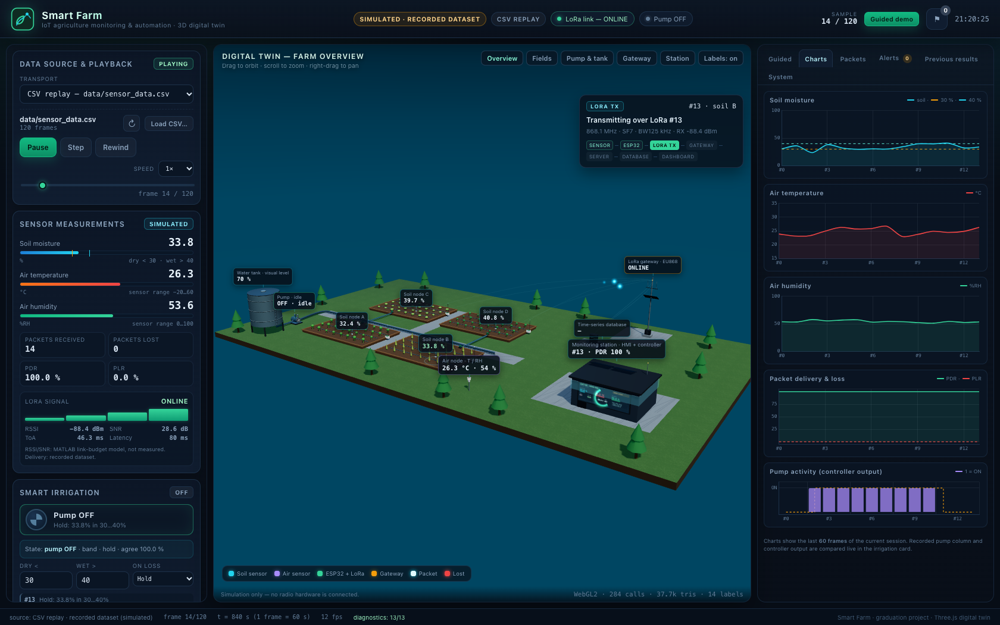
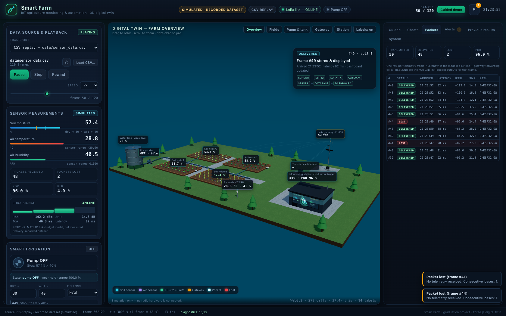
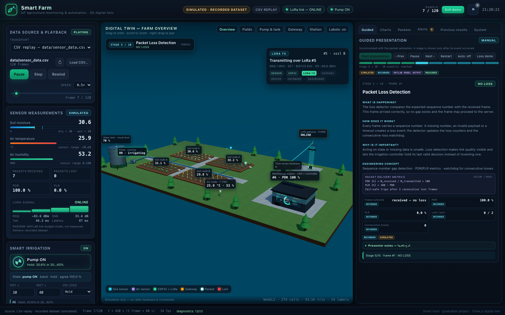
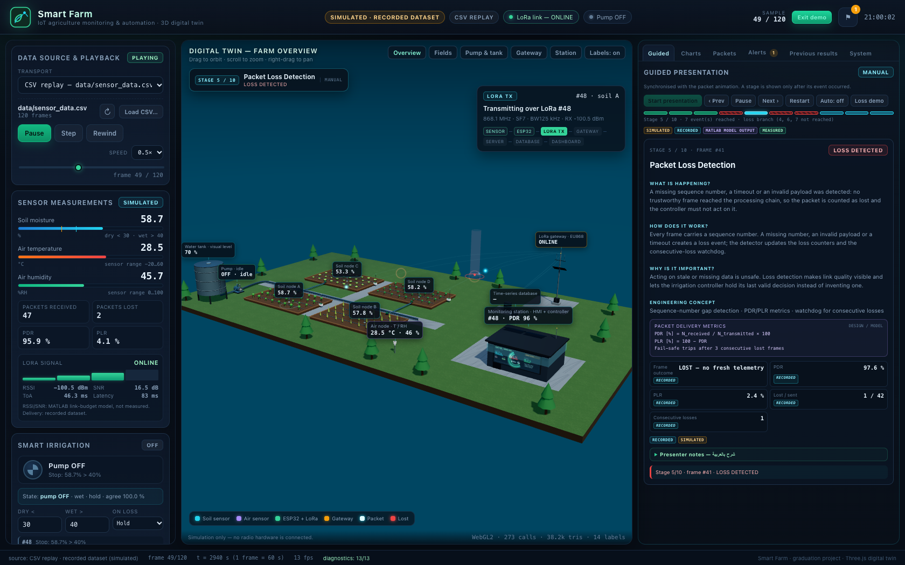
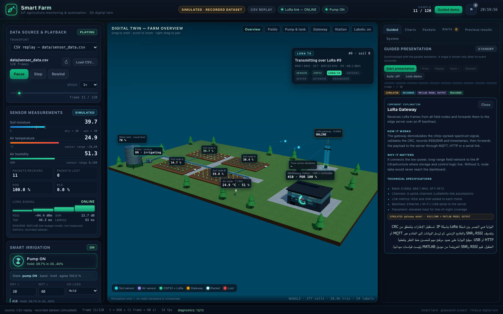

# Smart Farm 3D — IoT Monitoring & Automation Dashboard

A Three.js **digital twin** of a smart farm that replays the recorded dataset of this
graduation project in real time: 3D farm, animated LoRa packets, live charts,
automatic irrigation, alerts and in-page self-diagnostics.



*Replay at frame 14/120: cyan packet in flight over LoRa TX, four field nodes,
pump/valve state, threshold charts and 13/13 diagnostics.*

> **Honesty first.** No sensor, pump or radio is connected in the default mode.
> Values come from `data/sensor_data.csv` (the recorded simulation dataset) and
> are labelled **SIMULATED** everywhere. RSSI/SNR are the output of the MATLAB
> link-budget model. The dashboard only says **MEASURED** when a real serial or
> MQTT device is connected.

---

## 1. Quick start (macOS Intel, VS Code)

```bash
# 1. open the project folder in VS Code
cd /path/to/SmartFarm_Simulation_English

# 2. start the local web server (serves the project root on port 8080)
./web3d/run_web.sh
```

The script prints `http://localhost:8080/web3d/` and opens your browser.

**Manual alternative** (any Python 3):

```bash
cd /path/to/SmartFarm_Simulation_English
python3 -m http.server 8080 --bind 127.0.0.1
# then open http://localhost:8080/web3d/
```

**Important:** open the page through `http://localhost`, **not** by double-clicking
`index.html`. Browsers block ES modules and `fetch()` on `file://` pages.

No `pip install` and no `npm install` are needed: Three.js, OrbitControls, Chart.js
and MQTT.js are vendored inside `web3d/vendor/` so the dashboard works offline.

> **Online demo:** <https://moneerasameer.github.io/SmartFarm_Simulation_English/web3d/>
> (published automatically by `.github/workflows/pages.yml`). The repository
> tests run in `.github/workflows/ci.yml` on every push.

Stop the server with `Ctrl+C`.

---

## 2. What you can demonstrate

| # | Requirement | Where to look |
|---|---|---|
| 1 | 3D farm: fields, crops, pipes, tank, pump, soil/air sensors, ESP32 nodes, LoRa gateway, monitoring station | 3D viewport, camera presets, legend |
| 2 | Real-time measurements + source honesty | left panel “Sensor measurements”, header badge |
| 3 | Animated data path sensor → ESP32 → LoRa TX → gateway → server → DB → dashboard, delivered/lost/in-flight, arrival time | flying packets + “Data flow” HUD + Packets tab |
| 4 | Smart irrigation 30 % / 40 % hysteresis, hold on stale data, visual pump + flowing water | left panel “Smart irrigation”, pump animation, pipe flow |
| 5 | Soil / temperature / humidity history, PDR, PLR, pump activity | Charts tab (5 Chart.js plots) |
| 6 | Professional engineering dashboard | full layout, alerts, diagnostics |
| 7 | Integration with the existing project | “Previous results” tab, `results/lora_link_trace.csv`, pump-agreement check |
| 8 | HTML/CSS/JS + Three.js + Chart.js + CSV import on macOS | this folder |
| 9 | Run instructions, architecture, hardware guide | this file + `docs/ARCHITECTURE.md` |

### Playback controls

* **Play / Pause** – replay the 120 frames (1.2 s per frame at 1×).
* **Step** – advance exactly one frame.
* **Rewind** – back to frame 1.
* **Speed** – 0.5× … 8×.
* **Scrub bar** – jump to any frame (the controller and statistics are replayed
  from the beginning so the state is always consistent).
* **CSV file picker** – load another dataset without restarting the server.
* **Root dataset** – reload `data/sensor_data.csv` from disk.

### Camera

Drag = orbit, scroll = zoom, right-drag = pan. Presets: **Overview / Fields /
Pump & tank / Gateway / Station**. The **Labels** button hides the 3D labels.

### Irrigation panel

* `Dry <` and `Wet >` thresholds (default 30 / 40 %).
* `On packet loss`: **Hold last state** (documented law) or **Fail-safe → OFF**
  (watchdog after 3 consecutive lost frames — same behaviour as the VHDL
  controller and the MATLAB “failSafe” strategy).
* “Dataset agreement” shows how often the live controller output equals the
  recorded `Pump` column (100 % with the default law).

Changing a threshold or the mode replays the session up to the current frame
with the new configuration — no invented data is introduced.

### Deep links (useful during the defence)

| URL parameter | Effect |
|---|---|
| `?frame=41` | jump to frame 41 (a recorded packet loss) |
| `?frame=38&play=1&speed=2&tab=packets` | play into the first loss and open the packet table |
| `?speed=8` | fast replay (one frame every 150 ms) |
| `?tab=alerts` / `?tab=system` | open the alerts or diagnostics tab directly |

Example: <http://localhost:8080/web3d/?frame=38&play=1&speed=2&tab=packets>



*Frame 49/120 after the recorded losses at samples 41 and 44: the table marks
them **LOST**, the delivery ratio drops to 95.9 % and toasts report the outage.*

---

## Guided presentation mode (academic demo)

Open the **Guided** tab (or press **Guided demo** in the top bar) for a
synchronised ten-stage explanation of one telemetry frame.





### The ten stages

| # | Stage | Engineering concept |
|---|---|---|
| 1 | Soil Moisture Sensing | dielectric sensing, calibration, sampling |
| 2 | ESP32 Data Acquisition and Processing | embedded acquisition, payload framing, CRC |
| 3 | LoRa Packet Transmission | chirp spread spectrum, time on air, duty cycle |
| 4 | LoRa Gateway Reception | LPWAN-to-IP gateway, CRC, RSSI/SNR |
| 5 | Packet Loss Detection | sequence gaps, PDR/PLR, watchdog |
| 6 | Edge Server Processing | validation, edge computing |
| 7 | Database Storage | time-series schema, append-only audit |
| 8 | Smart Irrigation Decision | hysteresis, hold, fail-safe |
| 9 | Pump Activation or Deactivation | relay actuation, safe state |
| 10 | Dashboard Monitoring | HMI, observability, provenance |

Each stage shows **what is happening**, **how it works**, **why it is
important**, the **engineering concept**, a formula, the live values of the
guided frame, provenance tags and a separate **Arabic presenter-notes**
section (`Presenter notes — شرح بالعربية`).

### Synchronisation rules

* The panel is **event driven**: a stage is marked as reached only when the
  packet animation reports the corresponding event.
* **Next** can only move through stages that have already occurred; it never
  runs ahead of the animation.
* The 3D view highlights the active component, the current connection and the
  packet status (`IN FLIGHT`, `NO LOSS`, `LOSS DETECTED`, `PUMP ON/OFF`,
  `UPDATED`).
* A lost frame takes the documented loss branch:
  `1 → 2 → 3 → 5 (loss) → 8 → 9 → 10`.
  Stages **4, 6 and 7 are marked “not reached”** and never shown as completed.
* **Pause** stops the replay (and therefore the events); **Resume** continues.
* **Auto play** follows the events automatically; manual mode is the default so
  the presenter can talk between two stages.

### Controls

| Control | Action |
|---|---|
| Start presentation | enters the mode, sets the replay to 0.5× and starts the packet flow |
| ‹ Prev / Next › | move between stages that have already been reached |
| Pause / Resume | stop or continue the replay and the stage events |
| Restart | rewinds to frame 1 and restarts the guided cycle |
| Auto: on/off | automatic vs manual stage advance |
| Loss demo | seeks to the first recorded packet loss and plays the loss branch |

Keyboard: `←` `→` step, `Space` pause/resume, `R` restart, `P` enter/exit,
`Esc` close a component explanation.

### Interactive component explanations

Click any of these objects in the 3D view: **soil sensors (A–D), air node,
ESP32 nodes (A–D), gateway, edge server, database cabinet, pump, water tank,
monitoring station**. The Guided tab opens a technical card with role, working
principle, specifications, data provenance and Arabic notes. A cyan ring/beam
marks the selected component.



### Presentation deep links

| URL parameter | Effect |
|---|---|
| `?present=1` | start the guided presentation in manual mode |
| `?present=1&auto=1` | start with automatic stage advance |
| `?present=1&demo=loss` | jump to the first recorded loss branch |
| `?present=1&step=4` | start and step four stages after the events arrive |
| `?component=gateway` | open the gateway component explanation directly |
| `?scan=1` | diagnostic: raycast every component and report the hit ids |

Example: <http://localhost:8080/web3d/?present=1&demo=loss&step=3>

### Data integrity in the presentation

Every value carries one of four tags:

| Tag | Meaning |
|---|---|
| `SIMULATED` | model / animation / controller output |
| `RECORDED` | field from the recorded dataset (simulated measurement campaign) |
| `MATLAB MODEL OUTPUT` | RSSI/SNR/airtime/latency from the MATLAB link model |
| `MEASURED` | live Web Serial or MQTT frame only |

---

## 3. Data provenance — what is real and what is not

| Item | Origin | Displayed as |
|---|---|---|
| Soil moisture, temperature, humidity, packet received, recorded pump | `data/sensor_data.csv` (existing recorded simulation) | **SIMULATED · recorded dataset** |
| RSSI, SNR, link margin, packet-error probability | `results/lora_link_trace.csv` (MATLAB `lora_link_budget.m`) | “model”, never “measured” |
| Airtime / latency | Semtech LoRa CSS formula, identical to `lora_time_on_air.m` | “modelled” |
| Packet loss | the recorded `Packet received` column | never generated by this page |
| Pump command | the documented control law applied to the frames | compared with the recorded pump |
| Tank water level | purely visual (70 %) | labelled “visual level” |
| Serial / MQTT frames | your hardware | **MEASURED** badge |

The header badge, the measurement card tag, the footer and the station screen all
repeat the data origin, so the audience can always see which mode is active.

---

## 4. How the 3D data path works

```
 soil probe ──► ESP32 + LoRa ──► gateway ──► edge server ──► (DB) ──► dashboard
     │              │               │              │                       │
  frame #n      encode/CRC      forward        validate +           3D labels,
  (recorded)    airtime 46 ms   to server      store in memory      charts, alerts
```

* Every replayed frame produces **one glowing packet** that travels along a
  Catmull-Rom curve through the real 3D positions of the sensor, node, antenna,
  gateway, server cabinet and station screen.
* A frame whose `Packet received` is `False` (or whose soil value is outside
  0…100 %) becomes **red** and fades out between the transmitter and the
  gateway; the stage chain turns red at “Gateway”.
* The HUD shows the current stage, frame number, RSSI and the modelled latency;
  the Packets tab lists every frame with status, latency, RSSI, SNR and path.
* When data is lost, the controller holds the last command. The sensor labels
  switch to “no frame” and the measurement card says “holding last frame” —
  the dashboard never presents stale data as a fresh measurement.

Sensor assignment: the dataset contains one telemetry frame per sample, while
the 3D farm has four soil nodes. Frames are distributed round-robin over the
four nodes (frame index mod 4) so every field is exercised; this mapping is
documented in the System tab and in `docs/ARCHITECTURE.md`.

---

## 5. Project structure

```
web3d/
├── index.html                 layout: header, panels, 3D viewport, tabs, footer
├── css/styles.css             engineering dark theme + guided presentation UI
├── js/
│   ├── main.js                orchestration, playback, transports, diagnostics, picking
│   ├── config.js              file paths, control + LoRa parameters, 3D layout
│   ├── data/
│   │   ├── csv.js             CSV parser (both header variants) + LoRa trace
│   │   ├── frame.js           JSON / CSV line parser for live transports
│   │   ├── serial.js          Web Serial transport (ESP32)
│   │   └── mqtt.js            MQTT over WebSocket transport
│   ├── logic/
│   │   ├── irrigation.js      control law (MATLAB/VHDL equivalent)
│   │   ├── lora.js            airtime, link budget, link statistics
│   │   └── alerts.js          alert engine
│   ├── presentation/
│   │   ├── stages.js          10 stages + component dictionary (EN/AR)
│   │   └── controller.js      event-driven guided stage state machine
│   ├── scene/
│   │   ├── world.js           procedural farm, DB, highlights, raycast picking
│   │   ├── packets.js         animated packets, loss effects, stage events
│   │   └── labels.js          HTML labels anchored to 3D positions
│   └── ui/
│       ├── panels.js          gauges, link card, irrigation card, header
│       ├── charts.js          five Chart.js plots
│       ├── packet-view.js     packet table + stage chain
│       ├── alert-view.js      alert list + toasts
│       ├── presentation-view.js  guided panel, controls, Arabic notes, components
│       └── diagnostics.js     in-page PASS/FAIL checks
├── vendor/                    three.js r160, OrbitControls, Chart.js 4, MQTT.js
├── docs/ARCHITECTURE.md       engineering documentation
├── assets/                    dashboard and guided-presentation screenshots
├── tests/
│   ├── verify_web3d.py        static verification (no browser needed)
│   ├── logic-test.html        13 data/control/LoRa assertions in the browser
│   ├── presentation-test.html 29 guided-stage / loss-branch / control assertions
│   └── run_browser_checks.sh  static + logic + presentation + dashboard checks
└── run_web.sh                 local server helper
```

---

## 6. Self-diagnostics (show this to the committee)

Open **System → Self-diagnostics**. The page runs 13 checks and prints
`PASS/FAIL` plus a short detail, e.g.:

```
PASS  Dataset loaded — 120 frame(s) from sensor_data.csv
PASS  Control law matches recorded pump — 100.00 % agreement over 120 frame(s)
PASS  LoRa link-budget trace joined — 120/120 frames have RSSI/SNR model data
PASS  Five charts created — 5 Chart.js instance(s)
PASS  3D scene is rendering — 78 draw call(s) · 41k triangles
PASS  No runtime errors — 0 errors captured
```

The result is also written to `<body data-diag="13/13">` which makes automated
verification easy.

### Reproducible verification

```bash
.venv/bin/python web3d/tests/verify_web3d.py     # static, no browser
./web3d/tests/run_browser_checks.sh              # static + browser + boot
```

The browser script starts a temporary server, runs
`web3d/tests/logic-test.html` (CSV aliases, invalid ranges, hysteresis,
fail-safe watchdog, live frame parser, airtime, dataset agreement, LoRa trace),
then `web3d/tests/presentation-test.html` (stage order, loss branch, skipped
stages, manual Next/Previous, pause/resume, restart, auto play, component
explanations) and finally boots the dashboard to read its self-diagnostics,
the guided-presentation state and the raycast component picking. The current
state is **8/8 static, 13/13 logic, 29/29 presentation, 13/13 runtime,
0 runtime errors, picking OK**.

---

## 7. Connecting real hardware later

### 7.1 Bill of materials (suggested)

| Item | Example part | Purpose |
|---|---|---|
| MCU + radio | ESP32 DevKit + SX1276/RFM95 868 MHz | sensor node / LoRa transmitter |
| Soil sensor | capacitive soil moisture v1.2 (analog) | soil moisture 0…100 % |
| Air sensor | DHT22 (or SHT31) | temperature + humidity |
| Gateway | second ESP32 + SX1276, USB to the laptop | LoRa → USB serial or MQTT |
| Pump + relay | 5 V relay module + low-voltage pump | actuator demonstration |
| Power | 5 V supply / power bank | safe lab setup |

Never switch mains voltage on a student demo; use a low-voltage pump or an LED
strip that represents the pump.

### 7.2 Wiring (sensor node)

| Signal | ESP32 pin |
|---|---|
| Capacitive soil sensor AO | GPIO 34 |
| DHT22 data | GPIO 4 (10 kΩ pull-up to 3.3 V) |
| LoRa SCK / MISO / MOSI / NSS | GPIO 5 / 19 / 23 / 18 |
| LoRa RESET / DIO0 | GPIO 14 / 26 |
| Pump relay IN | GPIO 27 |

### 7.3 Arduino sketch (prints one JSON frame per line)

```cpp
#include <DHT.h>
#include <SPI.h>
#include <LoRa.h>

#define SOIL_PIN 34
#define DHT_PIN  4
#define PUMP_PIN 27
DHT dht(DHT_PIN, DHT22);

void setup() {
  Serial.begin(115200);
  dht.begin();
  pinMode(PUMP_PIN, OUTPUT);
  digitalWrite(PUMP_PIN, LOW);
  LoRa.setPins(18, 14, 26);          // NSS, RESET, DIO0
  if (!LoRa.begin(868.1E6)) {
    Serial.println("{\"error\":\"LoRa init failed\"}");
  }
  LoRa.setSpreadingFactor(7);
  LoRa.setSignalBandwidth(125E3);
  LoRa.setCodingRate4(5);
}

void loop() {
  int raw = analogRead(SOIL_PIN);                 // 0…4095
  float soil = constrain(map(raw, 4095, 1200, 0, 100), 0, 100);
  float t = dht.readTemperature();
  float h = dht.readHumidity();
  static unsigned long frame = 0;
  frame++;

  char payload[96];
  snprintf(payload, sizeof(payload),
           "{\"sample\":%lu,\"soil\":%.1f,\"temperature\":%.1f,\"humidity\":%.1f,\"packet_received\":true}",
           frame, soil, t, h);

  // 1) debug/telemetry stream for the dashboard
  Serial.println(payload);

  // 2) radio transmission (the gateway prints what it receives)
  LoRa.beginPacket();
  LoRa.print(payload);
  LoRa.endPacket();

  delay(60000);   // same 60 s cadence as the dataset (demo: use 3000)
}
```

The gateway sketch forwards `LoRa.parsePacket()` payloads to its USB serial port
with the same JSON line format, or publishes them to MQTT.

### 7.4 Web Serial mode (measured)

1. Connect the gateway (or the node directly) by USB.
2. In the dashboard choose **Transport → Web Serial — ESP32 (measured)**.
3. Press **Connect serial** and pick the port (`/dev/cu.usbserial-*` or
   `/dev/cu.SLAB_USBtoUART`).
4. The badge switches to **MEASURED · live sensor**, the serial log shows the raw
   lines, and every received frame is animated and charted.

Requirements: Chrome/Edge on `http://localhost` (secure context) and permission
to access the serial port. macOS may ask for a driver for CH340/CP210x adapters.
Live frames are attached to **soil node A** in the 3D view (one physical node is
assumed); every frame is still transmitted through the full animated path.

### 7.5 MQTT mode (measured)

Broker example (`mosquitto.conf`):

```conf
listener 1883
allow_anonymous true
listener 9001
protocol websockets
```

Then in the dashboard: **Transport → MQTT over WebSocket**, broker
`ws://localhost:9001/mqtt`, topic `smartfarm/telemetry`, press **Connect MQTT**.
Publish frames as JSON:

```json
{"sample": 1, "soil": 27.4, "temperature": 24.8, "humidity": 51.2, "packet_received": true}
```

The parser accepts the same normalised keys as the CSV
(`SoilMoisture`, `AirHumidity`, …), plain comma-separated values, and also
`packet_received: false` to simulate a loss.

---

## 8. Troubleshooting

| Symptom | Cause / fix |
|---|---|
| 3D area is black / “Something went wrong” | WebGL disabled — enable hardware acceleration, try Chrome/Edge. |
| “The CSV cannot be fetched from a file:// page” | Open `http://localhost:8080/web3d/`, not `index.html`. |
| CSV tab shows no data | `data/sensor_data.csv` missing or header changed — use **Load CSV…**. |
| Charts empty | `vendor/chart.umd.js` missing (re-download or check the console). |
| “Web Serial is not available” | Use Chrome/Edge on localhost; Safari/Firefox do not implement Web Serial. |
| MQTT “connection timed out” | Broker must expose a **WebSocket** listener (port 9001), not only TCP 1883. |
| Labels overlap / too small | Zoom out or press **Labels: off**. |
| Slow rendering on an old GPU | Use 0.5× speed, close other GPU-heavy apps; draw calls are already instanced. |
| Port 8080 busy | `PORT=8090 ./web3d/run_web.sh`. |

---

## 9. Presentation script (7 minutes)

1. **Context (30 s)** — one slide on the original project: MATLAB analysis,
   Python dashboard, LoRa model, VHDL controller, SystemC model.
2. **Open the dashboard (30 s)** — say clearly: *“default mode replays the
   recorded data; the badge says SIMULATED.”*
3. **3D tour (1 min)** — Overview → Fields → Pump & tank → Gateway → Station.
4. **Data path (1.5 min)** — point at a flying cyan packet, then at the stage
   chain; wait for a lost frame (samples 41, 44, 96 and one more) and show the
   red packet, the “holding last frame” tag and the alert.
5. **Irrigation law (1 min)** — show 30/40 thresholds, a dry frame turning the
   pump ON, the impeller + flowing pipes, then a wet frame turning it OFF.
6. **Charts (1 min)** — soil with threshold lines, PDR/PLR, pump activity; note
   that the dashed line is the recorded pump and the bars are the controller.
7. **Engineering evidence (1 min)** — System tab: 13/13 diagnostics, control-law
   agreement, MATLAB/VHDL/SystemC transcripts in “Previous results”.
8. **Hardware path (1 min)** — switch to Web Serial, connect the ESP32 (if
   available), show the MEASURED badge, then switch back to CSV.

---

## 10. Limitations (stated honestly)

* The default mode is a replay of recorded data — it is not a live measurement.
* The LoRa radio link is modelled; no RF transmission happens on the laptop.
* RSSI/SNR are model outputs, not measured values.
* The 3D tank level and pipe flow are visualisations, not sensor readings.
* The database is an in-memory session store; there is no SQL server.
* Time on the station screen is wall-clock time, while the dataset timestamp is
  the frame index at a 60 s cadence (documented in the footer).
